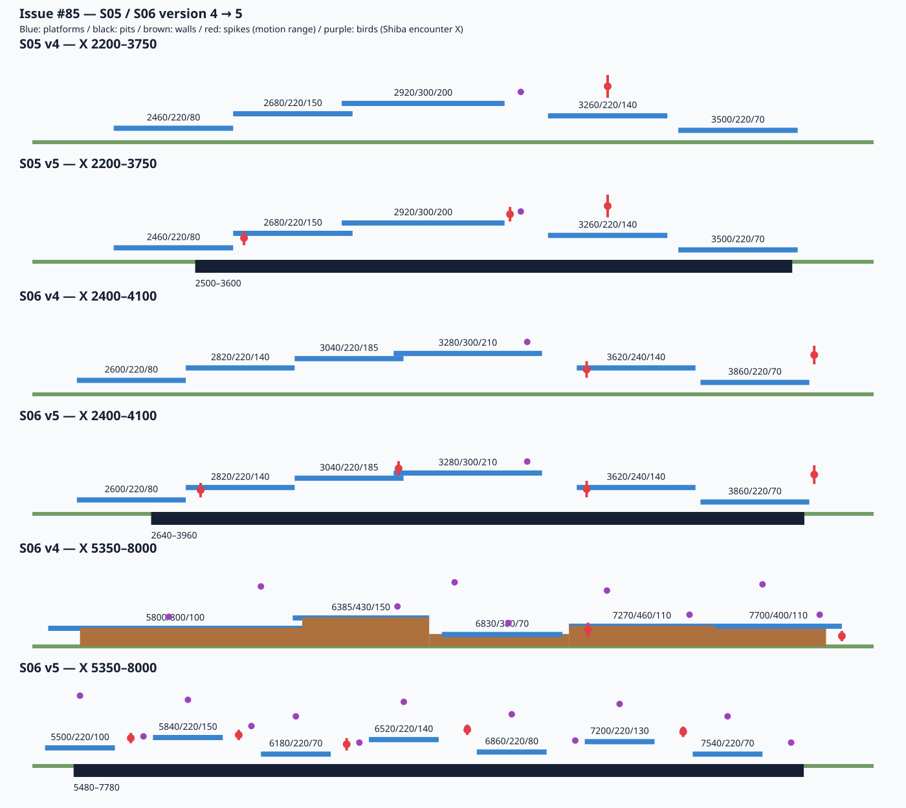
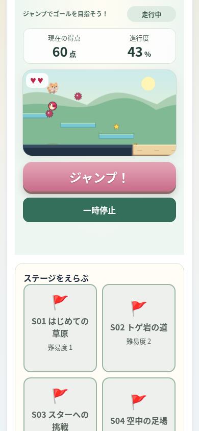
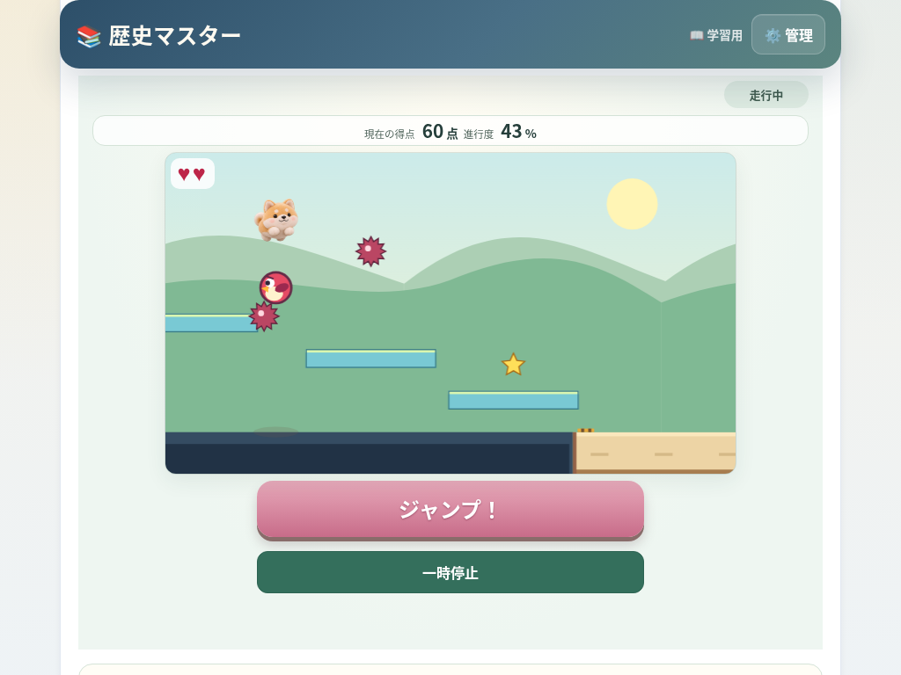
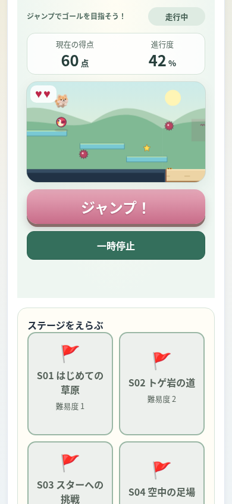
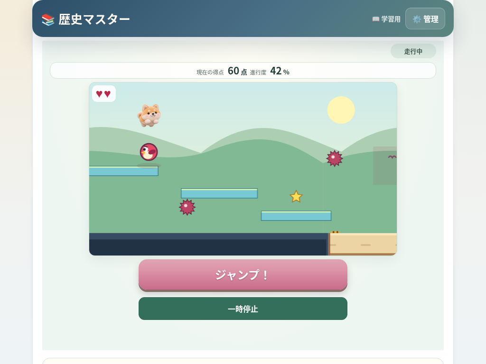
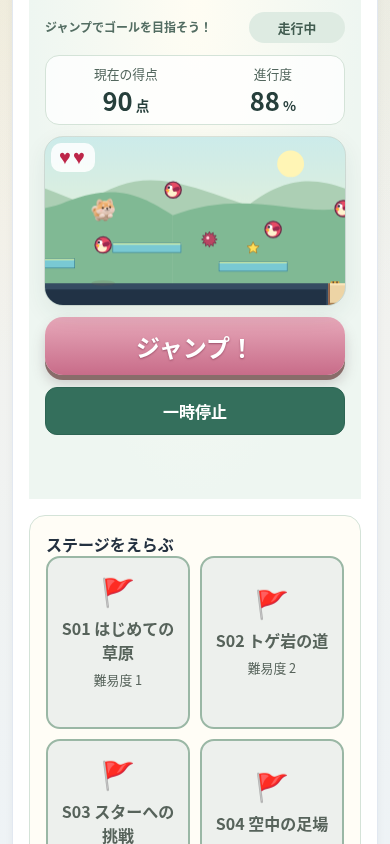
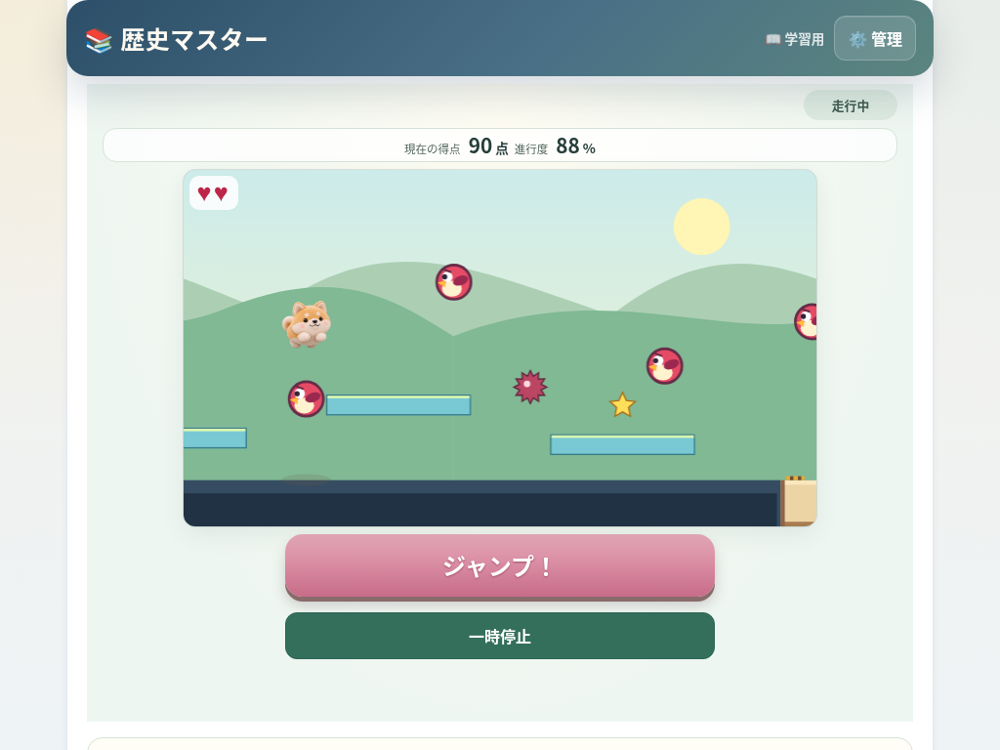

# Issue #85 高所登り必須化・S06最終連続足場

基点：main v1.7.48（PR #133マージ済み）。新規購入のみS05/S06版5、APP_VERSION v1.7.49。Refs #85（クローズしない）。

図の足場ラベルは中心X / 幅 / 地面からの高度（論理px）。鳥はしば犬との遭遇X（初期世界X÷1.6）。実際の鳥は初期世界Xから左へ120px/s。

## 穴と攻略物理

| ステージ | 穴の開始〜終了X | 長さ |
|---|---:|---:|
| S05中盤 | 2500〜3600 | 1100 |
| S06中盤 | 2640〜3960 | 1320 |
| S06終盤 | 5480〜7780 | 2300 |

通常しば犬は速度200px/s、ジャンプ高度120px、同高度へ戻るまで0.9秒（水平180px）。通常キャラの地上ジャンプ最長でも金魚の194.25pxで、中盤の穴より十分短い。最初の足場左端はS05=2350、S06=2490で、穴まで150px（0.75秒）。代表入力では穴より手前のX2483.3 / X2623.3で着地する。穴への無操作進入、地上からの単発ジャンプ、再ジャンプ省略を実物理で確認する。

足元中心の地面判定・描画座標、足場の足幅±20px、下降時着地処理、fatal判定をそのまま再利用。版5だけholeFailure="fatal"。足場接地中は穴による終了なし。落下して足元が地面Y470より下になれば、ハート・無敵に関係なく終了する。

S06のX4100〜5400のコースイベント・警告・罠4羽は版4から保持。穴はその手前で終了する。S05上下分岐も保持。

## 高所足場と終盤足場

| ステージ・区間 | 中心X | 幅 | 高度 |
|---|---:|---:|---:|
| S05 中盤 | 2460 | 220 | 80 |
| S05 中盤 | 2680 | 220 | 150 |
| S05 中盤 | 2920 | 300 | 200 |
| S05 中盤 | 3260 | 220 | 140 |
| S05 中盤 | 3500 | 220 | 70 |
| S06 中盤 | 2600 | 220 | 80 |
| S06 中盤 | 2820 | 220 | 140 |
| S06 中盤 | 3040 | 220 | 185 |
| S06 中盤 | 3280 | 300 | 210 |
| S06 中盤 | 3620 | 240 | 140 |
| S06 中盤 | 3860 | 220 | 70 |
| S06 終盤 | 5500 | 220 | 100 |
| S06 終盤 | 5840 | 220 | 150 |
| S06 終盤 | 6180 | 220 | 70 |
| S06 終盤 | 6520 | 220 | 140 |
| S06 終盤 | 6860 | 220 | 80 |
| S06 終盤 | 7200 | 220 | 130 |
| S06 終盤 | 7540 | 220 | 70 |

終盤は7足場、端間隔120px。100→150→70→140→80→130→70へ変化。上りでは下降側の着地が早く、下りでは長く飛ぶため入力タイミングが変わる。全足場下を穴とし、地上の迂回路をなくす。跳ぶのが早すぎると上り足場手前で下降し、遅すぎると足場から落ちてジャンプを受け付けない。崩れる足場・距離延長は実装しない。

## 鳥と上下移動トゲ

S05は鳥12羽を維持し、トゲ4→6個（中盤+2）。S06は鳥16→21羽（後半9羽を14羽へ再設計、計+5）。トゲ6→11個（中盤+2、終盤2→5個で+3）。

**S06終盤の全14羽（旧終盤9羽は版4に保持）**

| 初期世界X | しば犬遭遇X | 高度 | 世界速度 |
|---:|---:|---:|---|
| 8800 | 5500 | 340 | 左120px/s |
| 9120 | 5700 | 143 | 左120px/s |
| 9344 | 5840 | 320 | 左120px/s |
| 9664 | 6040 | 193 | 左120px/s |
| 9888 | 6180 | 240 | 左120px/s |
| 10208 | 6380 | 113 | 左120px/s |
| 10432 | 6520 | 310 | 左120px/s |
| 10752 | 6720 | 183 | 左120px/s |
| 10976 | 6860 | 250 | 左120px/s |
| 11296 | 7060 | 123 | 左120px/s |
| 11520 | 7200 | 300 | 左120px/s |
| 11840 | 7400 | 173 | 左120px/s |
| 12064 | 7540 | 240 | 左120px/s |
| 12384 | 7740 | 113 | 左120px/s |

高い鳥は着地後に走って下を通り、低い鳥は穴越えのジャンプで飛び越える。最初の鳥は入口ジャンプと干渉しない高度340。鳥の上端は最も高くてもY102で切れない。

**新しい上下トゲ**（固定世界X、上下速度は周期から計算）

| ステージ | X | 基準高度 | 振幅 | 周期秒 | 位相rad | 最大上下速度px/s |
|---|---:|---:|---:|---:|---:|---:|
| S05 | 2590 | 115 | 35 | 2.7 | 0 | 81.4 |
| S05 | 3080 | 230 | 35 | 2.3 | 0 | 95.6 |
| S06 | 2740 | 115 | 35 | 2.5 | 0 | 88.0 |
| S06 | 3140 | 220 | 35 | 2.9 | 0 | 75.8 |
| S06 | 5660 | 135 | 25 | 2.4 | 0.6 | 65.4 |
| S06 | 6000 | 150 | 25 | 2.5 | 0.3 | 62.8 |
| S06 | 6340 | 105 | 30 | 2.7 | 1.2 | 69.8 |
| S06 | 6720 | 175 | 25 | 2.9 | 1.7 | 54.2 |
| S06 | 7400 | 165 | 25 | 3.1 | 2 | 50.7 |

既存spikeCenterの高度 = 基準高度 + 振幅×sin(2π×elapsed/周期+位相)。描画・衝突・保存復帰で共用し、乱数・実時間には依存しない。

## 代表しば犬のジャンプ時刻（秒）

- S05: 1.65, 2.95, 4.25, 5.825, 6.65, 7.7, 8.8, 10.55, 11.7, 12.65, 13.75, 15.05, 22.85, 24, 25.05, 27.3, 28.4, 30.8, 31.8, 33.35, 35
- S06: 1.65, 2.85, 4.05, 5.825, 6.65, 7.7, 8.85, 9.85, 11.35, 12.4, 13.35, 14.3, 15.2, 16.55, 25.85, 26.8, 28.0, 29.7, 31.4, 33.1, 34.8, 36.5, 38.2

S06上ルートは26.8秒を26.95秒へ置換し、20.55・21.65秒を追加する。下ルートは追加なしで100点・ハート2、上ルートは罠の鳥に被弾して100点・ハート1。

## 主要ジャンプの入力幅

他入力は固定し、対象入力だけ1/60秒ずつ移動。全ジャンプ受理・最高段着地・無傷100点で連続する範囲。複数入力を同時にずらした場合を保証しない。探索上限は各方向0.6秒。

| ステージ | 基準秒 | 成功区間秒 | 幅秒 |
|---|---:|---|---:|
| S05 | 1.65 | 1.483〜1.817 | 0.333 |
| S05 | 2.95 | 2.783〜3.117 | 0.333 |
| S05 | 4.25 | 4.083〜4.417 | 0.333 |
| S05 | 5.825 | 5.508〜5.958 | 0.450 |
| S05 | 6.65 | 6.517〜6.783 | 0.267 |
| S05 | 7.7 | 7.517〜7.817 | 0.300 |
| S05 | 8.8 | 8.650〜8.967 | 0.317 |
| S05 | 10.55 | 10.383〜10.717 | 0.333 |
| S05 | 11.7 | 11.450〜11.933 | 0.483 |
| S05 | 12.65 | 12.417〜12.783 | 0.367 |
| S05 | 13.75 | 13.400〜14.033 | 0.633 |
| S05 | 15.05 | 14.817〜15.183 | 0.367 |
| S05 | 22.85 | 22.250〜23.017 | 0.767 |
| S05 | 24 | 23.667〜24.083 | 0.417 |
| S05 | 25.05 | 24.867〜25.283 | 0.417 |
| S05 | 27.3 | 27.067〜27.383 | 0.317 |
| S05 | 28.4 | 28.167〜28.633 | 0.467 |
| S05 | 30.8 | 30.567〜30.900 | 0.333 |
| S05 | 31.8 | 31.700〜31.933 | 0.233 |
| S05 | 33.35 | 33.117〜33.583 | 0.467 |
| S05 | 35 | 34.800〜35.083 | 0.283 |
| S06 | 1.65 | 1.483〜1.817 | 0.333 |
| S06 | 2.85 | 2.683〜3.017 | 0.333 |
| S06 | 4.05 | 3.883〜4.217 | 0.333 |
| S06 | 5.825 | 5.525〜5.958 | 0.433 |
| S06 | 6.65 | 6.517〜6.783 | 0.267 |
| S06 | 7.7 | 7.517〜7.817 | 0.300 |
| S06 | 8.85 | 8.667〜8.983 | 0.317 |
| S06 | 9.85 | 9.717〜10.067 | 0.350 |
| S06 | 11.35 | 11.183〜11.500 | 0.317 |
| S06 | 12.4 | 12.250〜12.633 | 0.383 |
| S06 | 13.35 | 13.117〜13.367 | 0.250 |
| S06 | 14.3 | 14.133〜14.383 | 0.250 |
| S06 | 15.2 | 15.117〜15.350 | 0.233 |
| S06 | 16.55 | 16.400〜16.783 | 0.383 |
| S06 | 25.85 | 25.800〜26.017 | 0.217 |
| S06 | 26.8 | 26.567〜26.983 | 0.417 |
| S06 | 28 | 27.783〜28.067 | 0.283 |
| S06 | 29.7 | 29.517〜29.833 | 0.317 |
| S06 | 31.4 | 31.217〜31.467 | 0.250 |
| S06 | 33.1 | 32.967〜33.233 | 0.267 |
| S06 | 34.8 | 34.583〜34.933 | 0.350 |
| S06 | 36.5 | 36.433〜36.633 | 0.200 |
| S06 | 38.2 | 38.017〜38.333 | 0.317 |

## 互換性・検証

DB v10、backup v10、snapshot v2、schemaVersion 1を維持。旧版1〜4を変更せず、購入のstageVersionを使って再開。自動変換・追加課金・データ削除なし。S01〜S04の定義は不変。v1.7.48独立エンジンで版4の10状態と次軌道・全最新版定義の合成fixtureを生成。既存の版1〜3 fixtureと併用する。実データは使用しない。

検証結果と画面はドラフトPRに記載。Safari/WebKit/VoiceOver実機は未検証。iPhone縦390×844・iPad横1024×768はlocalhostの一時Chromiumで正式購入・実iframe・pointerdownを使って取得する。実機では高所・穴・鳥の予告と操作猶予、回転・画面復帰・スクロールを公開前に確認する。

## 限定テスト結果（localhost・一時Chromium）

重複実行を除く60件が成功。新規ascent 7件、既存vertical 13件（物理は版4を明示、正式購入/画面は版5）、density購入互換4件、phase1/phase2a/tuning購入互換13件、session 11件、storage 9件、最新版選択1件、親スクロール/画面復帰2件。最終トゲ5個に対する新規物理6件＋正式画面1件＋正式購入1件の8件は31.5秒で成功。主要入力幅の最小はS05=0.233秒、S06=0.200秒。

- 地上無操作：中盤登り入力を省略するとS05はX2501.7、S06はX2641.7で落下終了（60Hz）。
- 地上1ジャンプ：穴入口の0〜200px手前を5px刻み、ハート1/3・無敵0/100秒で計328通りを実物理で実行し、全例で穴を越える前に終了。足場・敵を除いた試験用コースで地上ジャンプ距離だけを分離して検証した。
- 順次着地：S05=80→150→200→140→70、S06=80→140→185→210→140→70。30/60/120Hzの代表攻略は開始と通常ジャンプのみ、座標・ハート・無敵補正なしで100点・無傷。
- 再ジャンプ省略：中盤の主要入力と終盤の全7入力を1つずつ省略し、穴への落下終了を確認。足場上にいる正常な全攻略では穴の誤判定なし。
- S06終盤：X5533.3 / 5760 / 6146.7 / 6430 / 6823.3 / 7120 / 7503.3で7足場へ着地。ジャンプの前に必ず接地し、全入力が受理される。最終はX7843.3で地上へ戻る（60Hz）。
- S06分岐：下ルートは100点・ハート2、上ルートは鳥の被弾を伴い100点・ハート1（30/60/120Hz）。旧版4の分岐イベントは完全一致。
- 追加鳥・トゲの接触内外境界、鳥の左120px/s、トゲ周期とCanvas描画頂点、各フレームのpause/restore/次ステップ一致を確認。
- 正式30コイン購入、途中保存・再読込・手動再開・結果・最高点・重複課金防止・混在バックアップを確認。版4の10状態はv1.7.48の次軌道と一致し、既存の版1〜3検証も成功。

全キャラ×全ステージ、学習/UFOのフル回帰、Safari/WebKit/VoiceOver実機は未実施。CIの最終結果はPRへ記載する。

## 実画面と動作動画

画像・動画は合成データ、正式30コイン購入、実iframe、通常ジャンプのpointerdownから取得。動画はゲーム内時間を20fpsで描画してCanvasを記録したもので、Safari実機や手動操作の録画ではない。

| 場面 | iPhone縦390×844 | iPad横1024×768 |
|---|---|---|
| S05中盤 |  |  |
| S06中盤 |  |  |
| S06終盤 |  |  |

- [S05中盤の穴越え（7.25秒）](screenshots/runner-85-ascent/s05-ascent.mp4)
- [S06中盤の穴越え（8.35秒）](screenshots/runner-85-ascent/s06-ascent.mp4)
- [S06終盤の連続ジャンプ（12.95秒）](screenshots/runner-85-ascent/s06-final.mp4)
- [S05実動作の時刻・位置・接地記録](screenshots/runner-85-ascent/s05-trace.json) / [S06記録](screenshots/runner-85-ascent/s06-trace.json)
