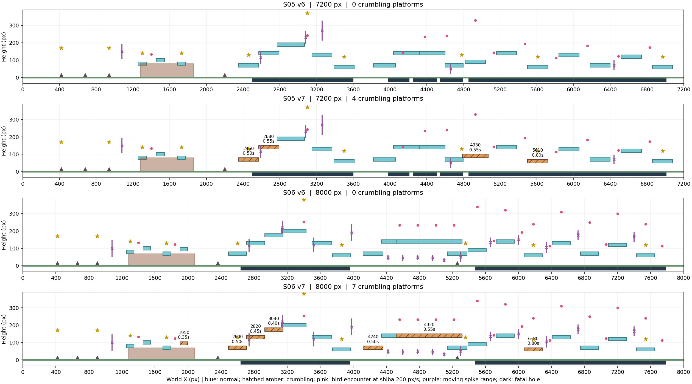

# Issue #85: S05/S06 崩れる足場（版7）

基点 main `85d4a63` / v1.7.50（PR #134・#135マージ済み）。APP_VERSION v1.7.51。Refs #85。新規購入のみ版7。S01〜S04とS05/S06版1〜6は不変。

## 動作と保存設計

連続接地方式を採用。茶色＋太い亀裂で通常の青い足場と区別し、着地直後に枝状の亀裂を追加、経過に応じて亀裂を広げて橙色にする。期限で足場を消す。通常足場のデザインは維持する。外部素材・サービスの追加なし。

ジャンプで連続接地の計測を解除し、再着地時に最初から計測する。空中でタイマーは継続しない。ジャンプ前に崩壊していなければ足場は残る。崩壊した足場は永久に消え、再着地できない。空中でも最初の着地から時限崩壊する方式ではない。

**DB v10 / backup v10 / snapshot v2 / schemaVersion 1と保存フィールドはすべて維持。**

- `landingUntil` は既存の着地アニメーションの終了時刻。接地中は変化せず、着地時刻を `landingUntil − CHARACTER_SET.landingSeconds（0.12秒）` から復元できる。意味や値の書き換えをせず、物理判定にも参照する。
- 崩壊は既存の `objects` 配列からの削除で表現する。追加のタイマー・破壊済みID・隠しフラグは保存しない。取得済みスターと同じく、消えたオブジェクトを保持しない。
- 固定の対象IDと秒数はステージ定義の `crumbling` に置き、購入版から再生成する。コースオブジェクトにフィールドを追加しない。
- 版7では定義された崩れる足場だけ不在を認める。最も早い水平接触＋必要秒数より前の削除は拒否する。残る全objectの項目・値・順序、通常足場、旧版の完全一致検証は維持。支持IDが消えた足場を指す保存も拒否する。
- 支持解除と削除は同時。サブステップ途中の期限まで接地し、その後の残り時間だけ重力で落下する。再開時に足場を補完しないため、崩壊後も不在が復元される。
- `animationTime` は走行中のゲーム内秒のみ。pause/非表示では進まない。実時計・RAF回数を使わない。

保存項目の追加が不要なため停止条件には該当しない。旧版の自動変換・再購入・返金・データ削除は行わない。旧アプリへの版7途中プレイの逆方向互換は保証しない（旧アプリには版7定義がない）。

## 配置と測定

[拡大SVG](screenshots/runner-85-crumbling/course-map.svg) / [新旧全配置JSON](screenshots/runner-85-crumbling/courses.json)

Xは世界座標の中心、幅・高度は論理px。ひび割れの強調は着地直後（0秒）。秒数は連続接地から崩壊まで。着地は解析式による実時刻、入力は代表しば犬120Hzルートの時刻。成功区間は60Hzで対象入力だけ1/60秒ずつ動かし、他入力を固定、全入力受理・無傷100点を維持する連続区間。

| ステージ | X | 幅 | 高度 | 崩壊秒 | 着地秒 | 再ジャンプ秒 | 入力成功区間（幅秒） |
|---|---:|---:|---:|---:|---:|---:|---|
| S05 | 2460 | 220 | 80 | 0.50 | 12.410 | 12.650 | 12.467〜12.783（0.317） |
| S05 | 2680 | 220 | 150 | 0.55 | 13.390 | 13.750 | 13.400〜13.933（0.533） |
| S05 | 4930 | 280 | 100 | 0.55 | 24.811 | 25.150 | 24.933〜25.350（0.417） |
| S05 | 5610 | 220 | 70 | 0.80 | 27.881 | 28.550 | 28.367〜28.667（0.300） |
| S06 | 1950 | 90 | 105 | 0.35 | 9.700 | 9.850 | 9.717〜10.050（0.333） |
| S06 | 2600 | 220 | 80 | 0.50 | 13.110 | 13.350 | 13.117〜13.367（0.250） |
| S06 | 2820 | 220 | 140 | 0.45 | 14.118 | 14.300 | 14.133〜14.383（0.250） |
| S06 | 3040 | 220 | 185 | 0.40 | 15.106 | 15.200 | 15.117〜15.350（0.233） |
| S06 | 4240 | 240 | 80 | 0.50 | 21.260 | 21.500 | 21.267〜21.600（0.333） |
| S06 | 4920 | 800 | 150 | 0.55 | 23.250 | 23.450 | 23.317〜23.583（0.267） |
| S06 | 6180 | 220 | 70 | 0.80 | 30.731 | 31.400 | 31.217〜31.467（0.250） |

S05は4か所。最初の中盤2足場で導入し、後半7足場では普通の足場と混在。X4930のみ幅220→280に広げ、0.55秒の期限を迎える前に端から出ないよう調整。S06は7か所。X2600→2820→3040は高度80→140→185、期限0.50→0.45→0.40秒の連続3足場。分岐入口と上段中央にも置き、対向鳥との再ジャンプを要求する。S06終盤7足場の座標・幅・高さと、中盤上下分岐は維持する。

しば犬の速度は200px/s、ジャンプ高さ120px・同高度滞空0.9秒。終盤の低い足場は次の高い足場まで端間隔120px・高低差70pxがあり、実ルートの着地→再ジャンプは約0.669秒。S05 X5610とS06 X6180で初期案の0.50〜0.55秒を使うと基準入力に間に合わず、入力幅0.20秒も保てないため、両方0.80秒に調整した。ほかはS05=0.50〜0.55秒、S06=0.40〜0.55秒。主要入力の最小成功幅は両ステージ0.200秒。複数入力を同時にずらす場合の保証ではない。

[全代表入力・順次着地・30/60/120Hz攻略](screenshots/runner-85-crumbling/physics.json) / [全入力成功幅](screenshots/runner-85-crumbling/input-windows.json) / [11足場×3Hzの着地・崩壊時刻](screenshots/runner-85-crumbling/timers.json)

## 失敗例と正式画面

後半の崩れる足場から次のジャンプを省略すると、S05はX5805、S06はX6375付近で足元が地面より下に入り、ハートが残っていてもfatal終了。崩壊した足場は表示・支持・再着地判定から同時に消える。[失敗記録](screenshots/runner-85-crumbling/failures.json)

以下はlocalhost・一時Chromium、合成データ、正式30コイン購入、実iframeのpointerdown入力。動画はゲーム内秒を0.05秒ずつ進めて20fpsで記録した検証用動画。Safari実機や人の手動プレイではない。

| ステージ・端末相当 | 着地後 | 崩壊直前 | 崩壊後 | 落下 | 結果 | 短い動画 |
|---|---|---|---|---|---|---|
| S05 iPhone縦390×844 | [画像](screenshots/runner-85-crumbling/s05-390-0.png) | [画像](screenshots/runner-85-crumbling/s05-390-1.png) | [画像](screenshots/runner-85-crumbling/s05-390-2.png) | [画像](screenshots/runner-85-crumbling/s05-390-3.png) | [画像](screenshots/runner-85-crumbling/s05-390-4.png) | [MP4](screenshots/runner-85-crumbling/s05-390.mp4) |
| S05 iPad横1024×768 | [画像](screenshots/runner-85-crumbling/s05-1024-0.png) | [画像](screenshots/runner-85-crumbling/s05-1024-1.png) | [画像](screenshots/runner-85-crumbling/s05-1024-2.png) | [画像](screenshots/runner-85-crumbling/s05-1024-3.png) | [画像](screenshots/runner-85-crumbling/s05-1024-4.png) | [MP4](screenshots/runner-85-crumbling/s05-1024.mp4) |
| S06 iPhone縦390×844 | [画像](screenshots/runner-85-crumbling/s06-390-0.png) | [画像](screenshots/runner-85-crumbling/s06-390-1.png) | [画像](screenshots/runner-85-crumbling/s06-390-2.png) | [画像](screenshots/runner-85-crumbling/s06-390-3.png) | [画像](screenshots/runner-85-crumbling/s06-390-4.png) | [MP4](screenshots/runner-85-crumbling/s06-390.mp4) |
| S06 iPad横1024×768 | [画像](screenshots/runner-85-crumbling/s06-1024-0.png) | [画像](screenshots/runner-85-crumbling/s06-1024-1.png) | [画像](screenshots/runner-85-crumbling/s06-1024-2.png) | [画像](screenshots/runner-85-crumbling/s06-1024-3.png) | [画像](screenshots/runner-85-crumbling/s06-1024-4.png) | [MP4](screenshots/runner-85-crumbling/s06-1024.mp4) |

PR #135の落下演出は変更しない。fatal時に終了・保存を確定し、キャラ全身がCanvas下へ消えるまで結果を遅らせる。

## 限定検証と残存項目

新規テストは11か所の自然着地、ひび割れ描画、指定時刻の削除、自由落下、空中での解除、pause、同じsnapshotからの次軌道、崩壊前後の実再読込、版6/7混在バックアップ、30/60/120Hz無傷100点、連続3足場、全入力成功幅、実iframe非表示・復帰を対象とする。独立したv1.7.50エンジンで生成した版6の10状態・次軌道と、全旧版1〜6の定義を固定fixtureで比較する。既存の版1〜5購入互換テストと正式購入・クリア記録・最高点・コイン・保存の限定回帰を併用する。

実行結果とCIリンクはPR本文に記録する。全キャラ×全ステージ攻略、学習機能・キャッチャー全面回帰はIssue #74方針に従い省略する。

Safari/WebKit/VoiceOver実機は未検証。公開前の実機レビューでは、iPhone縦/iPad横で茶色・太いひびの識別と入力猶予、連続再ジャンプ、崩壊と落下の視認、全身消失後の結果、非表示/アプリ切替/回転/BFCache、親の自然なスクロールと保存再開を確認する。

mainマージ、タグ作成、本番デプロイ、Issue #85クローズは行わず、ドラフトPRでレビュー待ちにする。
