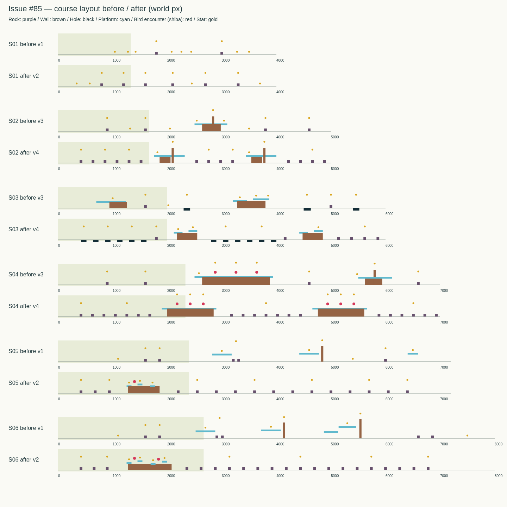
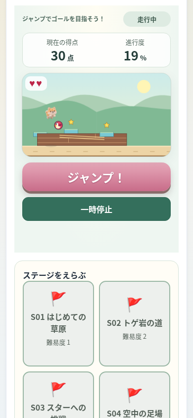
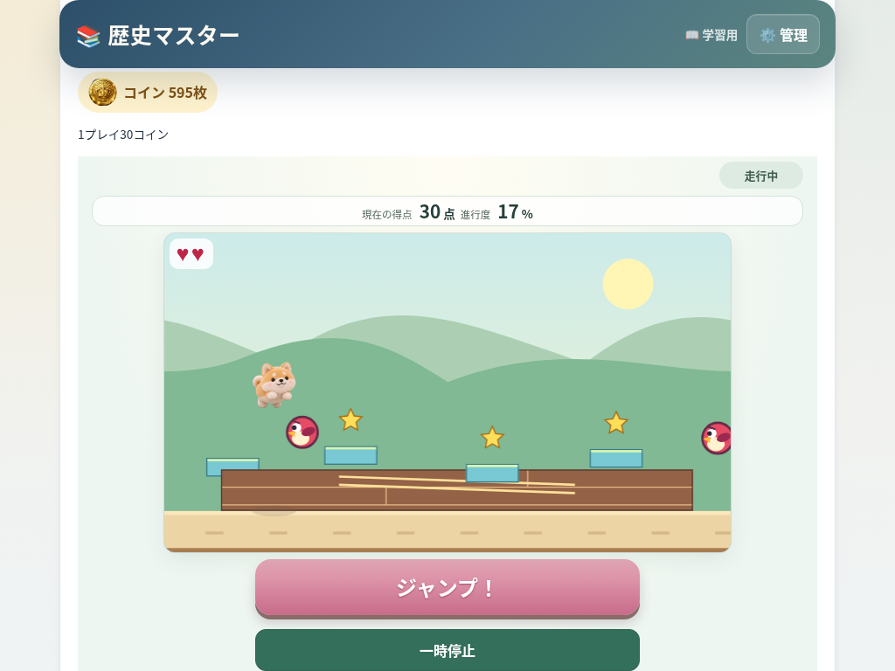

# Issue #85 全6ステージの高密度化（v1.7.46）

基点: main `ecbf869` / v1.7.45。Issue #74・#85、PR #128〜#130、AGENTS.md確認済み。新規購入のみ S01/S05/S06版2、S02/S03/S04版4。距離4,000/5,000/6,000/7,000/7,200/8,000、各10スター・最高100点を維持。

## 変更前後の配置・密度

[拡大用SVG](screenshots/runner-85-density/course-map.svg)

薄緑は最初の1/3。赤点はしば犬との遭遇位置（鳥の初期位置とは異なる）。岩は中心、壁・穴は左端、鳥は遭遇位置で序盤数と最初の危険物距離を数える。危険物は岩・壁・穴・鳥の実数。独立難所は岩単体・穴単体・連続する足場区間を1区間とし、足場下の壁や同じ区間の鳥を別区間として水増ししない。旧版の同一足場直下の近接岩2個も1区間。ジャンプ数は代表無傷ルートの操作数（数学的な最小数ではない）。

| Stage | 危険物 | 独立難所 | 序盤1/3危険物 | 最初の危険物までpx | 代表ジャンプ数 |
|---|---:|---:|---:|---:|---:|
| S01 | 2→6 | 2→6 | 0→2 | 1800→800 | 2→6 |
| S02 | 6→18 | 5→16 | 2→6 | 900→420 | 6→18 |
| S03 | 7→20 | 7→20 | 2→7 | 940→420 | 8→22 |
| S04 | 10→28 | 6→22 | 2→9 | 900→420 | 10→28 |
| S05 | 6→18 | 5→17 | 2→6 | 1600→420 | 8→20 |
| S06 | 8→24 | 7→22 | 2→8 | 1600→420 | 11→26 |

S03=20（2.86倍）、S04=28（2.8倍）は着地と入力猶予を確保した配置。残りは3倍。S01は最初のジャンプまで3.55秒の導入を残した。

## 通常しば犬の入力（秒）

開始・通常ジャンプのみ。座標・ハート・無敵の補正なし。全6ステージ30/60/120Hzで100点・ハート2・被弾0。

- S01: 3.55, 5.55, 7.55, 10.05, 13.05, 16.05
- S02: 1.65, 2.75, 3.85, 4.95, 6.05, 7.15, 8.3, 10.05, 12.25, 13.35, 14.45, 15.55, 16.7, 18.45, 20.65, 21.75, 22.85, 23.95
- S03: 1.95, 3.05, 4.15, 5.25, 6.35, 7.45, 8.55, 10.3, 11.35, 13.85, 14.95, 16.05, 17.15, 18.25, 19.35, 20.35, 21.8, 22.85, 25.25, 26.45, 27.65, 28.85
- S04: 1.65, 2.7, 3.75, 4.8, 5.85, 6.9, 7.95, 9, 10.45, 11.65, 12.85, 15.45, 16.5, 17.55, 18.6, 19.65, 20.7, 21.75, 22.8, 24.25, 25.45, 26.65, 28.95, 30, 31.05, 32.1, 33.15, 34.2
- S05: 1.65, 2.95, 4.25, 5.825, 6.65, 7.7, 8.8, 10.55, 12.3, 14.05, 15.8, 17.55, 19.3, 21.05, 22.8, 24.55, 26.3, 28.05, 29.8, 31.55
- S06: 1.65, 2.85, 4.05, 5.825, 6.65, 7.7, 8.85, 9.85, 11.35, 12.65, 13.95, 15.25, 16.55, 17.85, 19.15, 20.45, 21.75, 23.05, 24.35, 25.65, 26.95, 28.25, 29.55, 30.85, 32.15, 33.45

## 短い足場の物理と成功幅

しば犬: 速度200px/s、初速533.333px/s、重力1185.185px/s²、高さ120px、同高まで0.9秒＝180px。上り高さ差Δhの下降側着地時刻は `(v + sqrt(v² - 2gΔh))/g`。足場幅90px、足元半幅18pxを既存物理で使う。

- S05: 中心X=1300/1500/1730、高さ90/110/90。地上壁X=1280〜1860、高さ80。
- S06: 中心X=1300/1500/1740/1950、高さ90/110/80/105。地上壁X=1280〜2080、高さ70。
- 最短でも足場Aの左端からC/Dの右端は520/740pxあり、通常の1ジャンプで通過不能。地上壁は足場間と下を覆い、落下時に被弾する。A→B、B→C、C→D、最後の離脱にそれぞれ接地後の入力が必要。

| Stage/足場 | 着地（60Hz観測） | 次入力 | 成功入力区間 | 連続幅 |
|---|---:|---:|---|---:|
| S05/A | 6.517 | 6.650 | 6.517〜6.783 | 0.267秒 |
| S05/B | 7.517 | 7.700 | 7.517〜7.817 | 0.300秒 |
| S05/C | 8.650 | 8.800 | 8.650〜8.967 | 0.317秒 |
| S06/A | 6.517 | 6.650 | 6.517〜6.783 | 0.267秒 |
| S06/B | 7.517 | 7.700 | 7.517〜7.817 | 0.300秒 |
| S06/C | 8.667 | 8.850 | 8.667〜8.983 | 0.317秒 |
| S06/D | 9.717 | 9.850 | 9.717〜10.067 | 0.350秒 |

測定は60Hzで対象入力1つだけを1/60秒刻みでずらし、他の入力を固定して、全段着地・入力受理・100点無傷クリアが連続成功する範囲。全入力の同時変動への保証ではない。30Hzは5.825秒入力が5.833秒、他の入力も次のフレームに丸められるが順次着地と攻略は成立。全ルートの最小成功幅は0.233秒。

再ジャンプを全省略、足場なしの同じ入力は終了。個々の再ジャンプ省略はすべて地上壁への衝突を伴う（鳥を除いても再現）。単発のミスは既存ハート・無敵1秒によりハート1で終了地点へ進める場合がある。最終足場からの離脱省略ではS05 X=1853付近、S06 X=2073付近で壁に衝突。落下を一律ゲームオーバーに変えるのは穴だけで、壁の救済ルールは維持。

## 高速対向鳥

S04: 遭遇X=2180/2420/2660/4940/5180/5420、高さ143。S05: 遭遇1400、高さ133。S06: 遭遇1400/1840、高さ133/123。初期世界Xは遭遇X×1.6。世界速度は左120px/s、しば犬との相対速度320px/s。S04は足場で再ジャンプ3回×2区間、S05/S06はA着地後の鳥越えとBへの移動を同じジャンプで行う。S06ではCからの鳥越えがDへの移動を兼ねる。

既存 `birdCenter` を描画・衝突が共有し、`x = 186 + bird.x - distance - speed * elapsed`。鳥の全身が右端から入ってから代表入力までS04約1.881秒、S05のA→B約1.981秒、S06 C→D約1.981秒（初回出現ではなく全身表示基準）。無操作では鳥に接触し、下へ降りると壁に接触する。旧S04版2は静止、版3は左40px/sのまま。

## 保存互換性

DB v10・backup v10・snapshot v2・schemaVersion 1、キー・型・検証形式は無変更。既存定義の配列順・穴回復・静止鳥・40px/s鳥を保持。新規購入は最新版、再開は購入時の版を厳密に取得。未知版保持・再購入防止も維持。

開始画面内の負のatイベントはcreateRunnerStateで既存objectsへ生成する。購入直後のnextSpawnと復元検証が一致し、開始前にも危険物が見える。旧版にはこの早期イベントがなく、旧初期snapshotに変化なし。基点v1.7.45から作成した公開可能な合成fixture18状態と、過去PRのfixtureを照合。旧購入の再開後0.1秒のsnapshot、追加課金なし、全ストアの値、混在バックアップと再読込後の鳥位置を確認。

## 代表スクリーンショット

localhost・一時Chromium、合成プロフィール。Safari実機ではない。正式30コイン購入画面でpointerdown入力し、各段着地と再ジャンプを通して全6ステージ100点・無傷の結果を保存。

## 限定テスト・未実施項目

検証結果とCIリンクはPR本文参照。新規density suiteは物理、実Canvas/RAF/pointerdown、正式購入・保存・結果、旧版互換、バックアップを対象。過去phase1/phase2a/tuning、session/storageも保持。UIの旧ルート期待値は購入版を明示し、最新の購入APIは新suiteで検証。

学習/UFOフル回帰、全キャラ×全ステージ攻略、Safari/WebKit/VoiceOver実機は未実施。

Safari実機で公開前に確認する項目:

1. iPhone縦・iPad横で短い青い足場と下の壁が識別でき、着地を見て次のタップが間に合うこと。子どもの操作感・密度を評価。
2. 鳥が右から左へ接近し、足場からのジャンプで回避できること。
3. 連続足場上・鳥越え中・被弾直後の一時停止→回転→復帰→再読込で位置とハートが一致し、スクロール位置が勝手に動かないこと。
4. 旧購入済みコースが同じ版で追加課金なしに再開できること。旧S03版2の落下復帰、旧S04版2静止／版3 40px/sを維持。
5. 新S03で穴へ落ちるとハート・無敵の有無を問わず即終了し、結果保存後に再進行しないこと。

mainマージ・タグ・本番デプロイは行わず、ドラフトPRでレビュー待ち。
