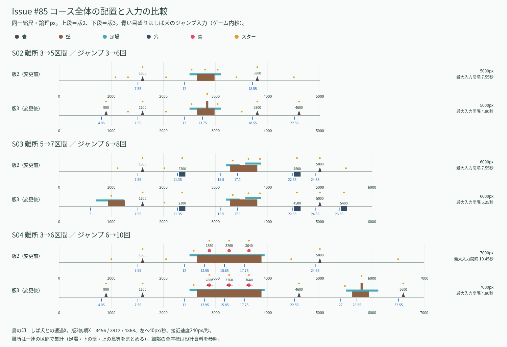

# Issue #85：障害物増量・穴即終了・対向する鳥

Refs #85。基点main `cf475f2`（PR #129マージ済み、v1.7.44）。S02/S03/S04の新規購入だけ版3へ更新。距離5000/6000/7000、各10スター・最高100点を維持。S01/S05/S06、全キャラ性能、30/0コイン、iframe・Canvas比率・操作ボタンは変更しない。APP_VERSIONと配信識別子はv1.7.45。

## 配置の比較

「難所」は、岩単体・穴単体・一連の足場攻略区間として集計する。足場、下の壁、上の鳥などは同じ区間にまとめて数え、物体の個数とは区別する。

| ステージ | 難所区間 版2→3 | 追加・調整 | 代表ルートのジャンプ数 | 最大入力間隔（開始・ゴール間を含む） |
|---|---|---|---|---|
| S02 | 3→5 | 前半900と後半4600の岩を追加。既存足場に高い壁を置き、着地後の再ジャンプを追加 | 3→6 | 7.55→4.80秒 |
| S03 | 5→7 | 前半700〜1240のブロック攻略と、後半5400〜5520の穴を追加。穴は版3だけ即終了 | 6→8 | 7.55→5.25秒 |
| S04 | 3→6 | 前半900の岩、後半5500〜6120の足場＋高い壁、6600の岩を追加。既存5000の岩を4600へ移動。鳥を左へ飛ばす | 6→10 | 10.45→4.80秒 |

最大入力間隔は測定した無傷100点ルートの入力時刻間隔であり、あらゆる攻略の上限ではない。S03の5.25秒には足場間ジャンプ後の着地・安全な降下を含む。



[拡大可能なSVG](screenshots/runner-85-tuning/course-map.svg)。同一縮尺で旧新版の全コース、スター、障害物とジャンプ時刻を描いた。鳥の印はしば犬との遭遇X。開始位置・速度は以下の通り。

## 版3の正確な配置

すべて論理px。Xはキャラ中心の通過距離、足場・壁の高さは地面から。足場は既存の上面着地物理、壁は足場にならない既存の衝突矩形を使う。

| ステージ | 岩の中心X | 足場（開始〜終端／高さ） | 壁（開始〜終端／高さ） | 穴 |
|---|---|---|---|---|
| S02 | 900,1600,3800,4600 | 2500〜3100／90 | 2640〜2980／80、2820〜2860／170 | なし |
| S03 | 1600,5000 | 700〜1240／80、3200〜3460／90、3570〜3870／110 | 940〜1260／70、3280〜3800／80 | 2300〜2420、4500〜4630、5400〜5520 |
| S04 | 900,1600,4600,6600 | 2500〜3940／100、5500〜6120／90 | 2640〜3880／90、5620〜5940／80、5780〜5820／170 | なし |

S03前半はブロックの終端1240を過ぎても、足の重なり幅と下降中の高さで壁終端1260を安全に越えることを実測確認した。S04後半は地上の壁を避けて足場へ着地し、上から高さ170の壁を越える。最初は高さ180で入力猶予0.167秒だったため、170へ下げて0.233秒に調整した。

スターの(中心X, 高さ)：

- S02：(900,120),(1320,0),(1600,120),(2050,0),(2540,90),(2840,210),(3040,90),(3500,0),(3800,120),(4600,120)。
- S03：(1000,80),(1600,120),(2020,0),(2360,120),(3330,90),(3630,110),(3850,110),(4560,120),(5000,120),(5460,120)。
- S04：(900,120),(1600,120),(2580,100),(2880,220),(3260,220),(3640,220),(4600,120),(5480,90),(5800,210),(6600,120)。

## 穴の即終了と旧版の復帰

新S03の定義だけに`holeFailure: "fatal"`を持つ。上面着地・穴の開始位置への到達時刻を扱う従来の物理は変更しない。足が論理地面Y=470より下へ出たサブステップで、通常のジャンプ・着地では復帰不能として終了する。

- 穴の上をジャンプしている間は足元Y≤470なので終了しない。穴の上を通過した距離だけでは判定しない。
- 終了時は`lives=0`、`reason="collision"`、`mode="finished"`。正式保存は既存の`result.reason="gameover"`、残機0。
- ハート1/2/3、無敵の有無を問わない。ワープ復帰なし。衝突・スター・ゴールより先に終了し、その後の走行、ジャンプ、加点は停止。
- 旧S03版2の定義にはfatalがないため、従来どおりY=640でハート1個消費、穴終端+60へ復帰、無敵1秒。共通処理からこの経路を削除しない。

## 対向する鳥

版3の鳥は初期世界X=3456/3912/4368、中心Y=327（地上から143）、世界速度40px/秒で左へ飛ぶ。輪郭込み半径28を維持。しば犬の右への速度200と合わせた接近速度は240px/秒。しば犬との遭遇は14.40/16.30/18.20秒、通過距離X=2880/3260/3640となる。

描画・衝突は同じ`birdCenter`を使う：

```
画面X = 186 + 初期世界X - state.distance - speed * state.elapsed
画面Y = 470 - height
```

旧版2ではspeed欠損を0として、元の固定世界座標をそのまま維持。新しい可変状態・snapshotフィールド・objects型は追加しない。既存elapsedをそのまま保存・復元するため、画面サイズ・DPR・実時間・乱数に依存しない。一時停止はelapsedも止まり、再開・再読込で同じ位置となる。足場上・鳥越え中の毎フレームと、混在バックアップ後の実際の文書再読込で位置とsnapshot全体が一致した。

版3の顔は左端のくちばし、左を見る片目、後ろ側の羽で飛行方向を示す。旧版2の正面顔は維持。両方とも輪郭と衝突円を共有し、羽を円内へclipする。鳥全体が画面内に入ってから基準ジャンプまで約2.66秒あり、接触の前に視認できる。鳥間の接近時間は1.9秒で、無敵1秒だけで連続通過する経路を主攻略にしない。地上の幅1240の壁を残し、鳥の下を走る経路を阻止する。

## 攻略入力と結果

通常キャラのしば犬へ、開始とジャンプだけを入力。位置やハートを補正せず、ゆにこを使わない。

| ステージ | ゲーム内ジャンプ秒 | 結果 |
|---|---|---|
| S02 | 4.05,7.55,12.00,13.75,18.55,22.55 | 30/60/120Hzで100点・ハート2・被弾0、5000pxクリア |
| S03 | 3.00,7.55,11.35,15.50,17.10,22.35,24.55,26.85 | 同条件で100点・ハート2・被弾0、6000pxクリア |
| S04 | 4.05,7.55,12.00,13.95,15.85,17.75,22.55,27.00,28.55,32.55 | 同条件で100点・ハート2・被弾0、7000pxクリア |

S02の13.75秒、S03の17.10秒、S04の13.95/15.85/17.75/28.55秒は足場上からの入力として受理される。実Canvas・RAF（時計だけ制御）・pointerdownで3ステージ×2画面サイズを完走。正式画面の既存ジャンプボタンでもS02/iPhone、S03/iPad、S04/両サイズの30コイン購入→100点・無傷の確定保存を確認した。

60Hzで各入力を1フレームずつ前後させ、無傷100点の連続成功幅を測定した。岩は0.333秒、S02の足場上の壁0.233秒、穴は0.233〜0.283秒、S03足場間0.483秒、動く鳥は各0.367秒、S04後半の壁0.233秒。登る入力には0.7秒以上の幅がある。単一フレームだけの解ではない。

無操作、全足場を除いた同じ入力、主要な連続操作の省略（S02は12/13.75秒、S03は17.10秒、S04は鳥越えの3入力）はゲームオーバー。S03は3つの穴それぞれの入力省略でも、その穴の範囲内で終了する。1回の操作失敗でハートが残るクリアは従来どおり認める。

## 保存互換性と限定テスト

DB v10・バックアップv10・snapshot v2・レコードschemaVersion=1を維持。旧記録・スコアの削除、推測変換、再購入要求はない。

- `VERSION2_STAGES`として旧S02〜S04の定義をそのまま保持し、版3を別配列へ追加。既存の`getStage(stageId,stageVersion)`で引き分ける。
- 新規購入の最新版一覧はS02/S03/S04が3、S01/S05/S06が1。親の再開対応表も1/2/3を許可。保存・復元は購入記録のIDと版を使用する。
- 元のv1.7.44エンジンから作成した独立した合成fixture13状態で、版2の購入直後、足場上、足場上ジャンプ、無敵、S03落下中・復帰後を検証。復元後0.1秒のsnapshotが旧エンジンの出力と完全一致。
- 旧版1のfixture、版2の復帰・静止鳥・攻略・保存テストは削除せず、版2を明示して継続。過去版の支払済み状態の合成ヘルパーはテストだけに置き、新規購入APIは版3専用テストで検証する。
- 版3の全成功経路・被弾/落下失敗経路の毎フレームで復元後の次フレームが一致。ハート1/2/3×無敵有無×30/60/120Hz×3穴で落下終了と正常な穴越えを確認。
- 旧版2/studentと新版3/testが混在するバックアップを各S02/S03/S04でJSON往復・v10検証・一時DB復元。全ストア完全一致と両版の再開を確認。S04は文書再読込後の鳥位置・snapshot全体も一致。版1/2とファイル選択によるバックアップUI復元は既存テストで継続確認。
- 新版3の各ステージの正式購入、保存、文書再読込、足場上/再ジャンプ中の再開、クリア、100点保存、1回だけの30コイン支出を確認。穴落下は正式gameoverとなり、既存履歴と終了後の状態を保持。

Issue #74に基づく限定実行。localhost・一時Chromium・公開可能な合成データだけを使った。重複再実行を除き54件の最終結果が成功。

- `runner_tuning_test`：11件。保存4件は初回成功、物理7件はテスト関数登録の不備を直して25.8秒で成功。最後の壁調整後に関連3件・6.4秒、再読込の座標完全一致を追加した1件・2.8秒を限定再実行。
- `runner_phase1_test`12件、`runner_phase2a_test`10件、`runner_session_test`11件、`runner_storage_test`9件、最新版一覧1件：計43件・53.0秒で成功。
- 変更JS構文、差分空白、コミット済みAPP_VERSION検査を実施。CIには版3専用11件を追加し、結果URLをPRへ記録する。

省略：全キャラ×全ステージ攻略、未変更S05/S06の全攻略、学習/UFOフル回帰、Safari/WebKit/VoiceOver実機。**子どもが実際に操作した際の難易度は未検証。** 他キャラの得意不得意も全攻略での確認はしていない。

## スクリーンショットとSafari実機確認

localhostの正式画面・合成履歴。ボタン・iframe高さ・比率は変更していない。

| 内容 | 画像 |
|---|---|
| S02 iPhone縦390×844、足場上から壁越え | [13.75秒の入力後](screenshots/runner-85-tuning/s02-iphone.png) |
| S03 iPad横1024×768、追加した最後の穴越え | [26.85秒の入力後](screenshots/runner-85-tuning/s03-ipad.png) |
| S04 iPhone縦、左向きの鳥越え | [14.30秒](screenshots/runner-85-tuning/s04-iphone.png)／[14.40秒](screenshots/runner-85-tuning/s04-iphone-later.png) |
| S04 iPad横、同じ区間 | [14.30秒](screenshots/runner-85-tuning/s04-ipad.png)／[14.40秒](screenshots/runner-85-tuning/s04-ipad-later.png) |

Safari実機でレビューする項目：

1. iPhone縦・iPad横で左向きの鳥の移動方向、岩、足場、壁、穴を見分けられるか。早めに見えて、着地と次の入力を判断できるか。
2. S02/S03/S04の密度が適切か。単純な連打ではなく、着地後の再ジャンプ・穴越えを子どもが練習して攻略できるか。
3. 穴に足を踏み外すとハート数・無敵を問わず即終了し、正常なジャンプ越えでは終了しないか。終了後は走行・加点を停止するか。
4. 鳥接近中・足場上・無敵中で一時停止、画面回転、アプリ切替、再読込/BFCache後に位置が一致し、手動再開待ちになるか。
5. 検証用の旧S03版2は穴復帰、旧S04版2は静止鳥のまま再開し、追加課金がないか。

既存の未コミットチェックポイントがページ破棄時に残らない制限は継続。旧アプリへダウングレードした場合の版3再開は保証しないが記録を保持する。旧各コースを保守する必要がある。mainマージ・タグ・本番デプロイは行わず、ドラフトPRでレビュー待ちとする。
