# Issue #85：穴落下演出・S05/S06版6

基点 main `ec943d6` / v1.7.49（PR #134マージ済み）。AGENTS.md、要件/設計資料、Issue #74/#85、PR #132〜#134と関連テストを確認。新規購入のみS05/S06を版6にし、APP_VERSIONと親/iframe/JS/CSSの識別子をv1.7.50へ同期する。

## 表示と保存

穴のfatal判定・終了理由collision・ハート0・結果保存の順序は変更しない。走行から終了への遷移を画面で観測した場合だけ、UIローカル変数に足元Yと下向き速度を保持し、既存の重力で落下を描く。距離・elapsed・スコア・スター・ハート・衝突・ゴールは終了したまま固定。画像最大寸法100pxを含め、足元Y−100がCanvas論理下端540以上になってから結果を表示する（足先だけで判定しない）。描画用コピーにのみ落下位置を適用する。

結果・再挑戦ボタン・親のステージ/キャラ選択は演出完了まで利用不可。結果保存は演出と独立して開始する。保存待ち・失敗でも消失前に結果を出さず、消失後に既存の保存中/無料復帰UIを使う。タブ非表示時は描画を止め、復帰/回転では前回時刻を捨てる。経過した非表示時間によるワープを防ぐ。初期状態が終了済みなら落下を再生しない。

穴の文言は「穴に落ちてしまった！もう一度挑戦しよう！」。通常衝突・旧回復型の穴の物理は変更しない。DB v10・backup v10・snapshot v2・既存の支払い/終了レコード形式に項目追加なし。

## 新旧配置図

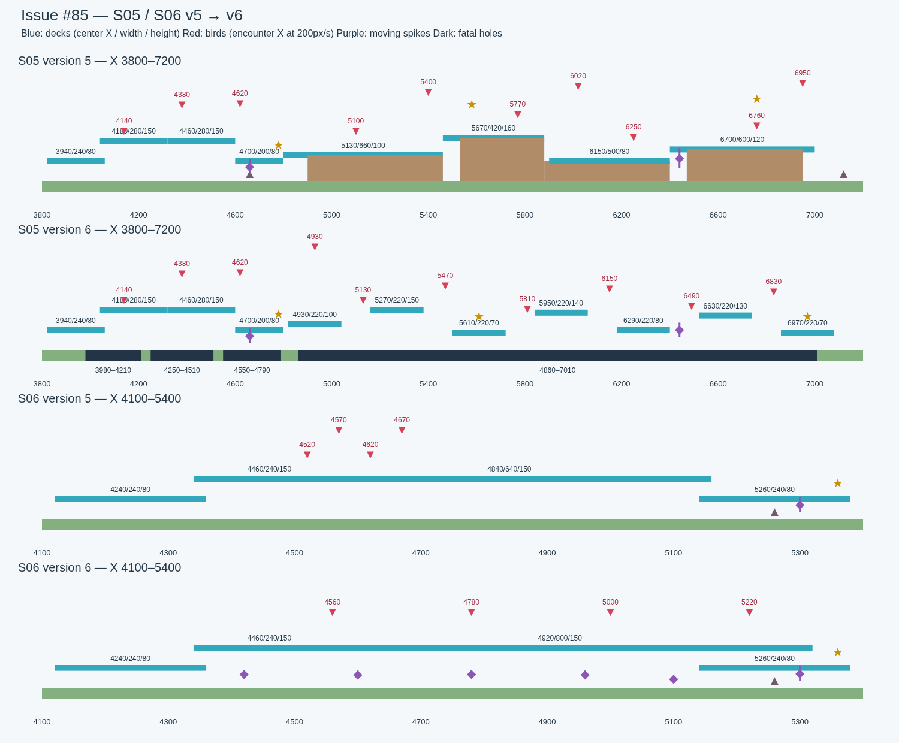

[拡大SVG](screenshots/runner-85-balance/course-map.svg)。足場は中心X/幅/地面からの高度。鳥は通常しば犬（速度200px/s）との遭遇X。初期世界Xは遭遇X×1.6、左向き120px/s。図はS05の55%前後〜100%とS06分岐を比較する。S05の2500〜3600の穴と高所登り、S06の2640〜3960/5480〜7780の穴、終盤7足場と全終盤敵は不変。

## S05：55%の穴と後半の足場

既存最初の足場は左端3820、最初の新穴は3980。足場左端から穴まで160px（しば犬0.8秒）。穴開始は横960のCanvas内で約3.87秒前から見える。代表ジャンプ19.05秒でX3953.3に着地してから穴に入る。地面を走るだけではX3981.7で終了する。

| 穴開始X | 終了X | 長さ | 用途 |
| --- | --- | --- | --- |
| 2500 | 3600 | 1100 | 既存高所 |
| 3980 | 4210 | 230 | 55%分岐 |
| 4250 | 4510 | 260 | 55%分岐 |
| 4550 | 4790 | 240 | 55%分岐 |
| 4860 | 7010 | 2150 | 連続足場下 |

| 足場中心X | 幅 | 高度 | 次への端間隔 |
| --- | --- | --- | --- |
| 3940 | 240 | 80 | -20 |
| 4180 | 280 | 150 | 0 |
| 4460 | 280 | 150 | 0 |
| 4700 | 200 | 80 | 20 |
| 4930 | 220 | 100 | 120 |
| 5270 | 220 | 150 | 120 |
| 5610 | 220 | 70 | 120 |
| 5950 | 220 | 140 | 120 |
| 6290 | 220 | 80 | 120 |
| 6630 | 220 | 130 | 120 |
| 6970 | 220 | 70 | — |

後半7足場は100→150→70→140→80→130→70px、端間隔120px。地上壁と岩を取り除き、足場の下を穴にした。幅660/420/500/600の長い足場を廃止。鳥12羽・上下トゲ6個を維持する。遅すぎる入力は足場端から落ちて受け付けず、早すぎる入力では次の高い足場より手前で下降する。

鳥はS05初めの5羽を保持。後半7羽の遭遇X/高度は4930/330, 5130/143, 5470/193, 5810/113, 6150/183, 6490/123, 6830/173。最初の高い鳥は足場に降りて下を通り、以降は足場間のジャンプで低い鳥を越える。X6440の上下トゲは新ルートに合わせ基準高度70・振幅25・周期2.6秒・位相0.5へ調整。ジャンプが遅れると接触する。

## S06：分岐の鳥4羽

| # | 旧遭遇X | 旧高度 | 新遭遇X | 新初期世界X | 新高度 |
| --- | --- | --- | --- | --- | --- |
| 1 | 4520 | 193 | 4560 | 7296 | 233 |
| 2 | 4570 | 280 | 4780 | 7648 | 233 |
| 3 | 4620 | 193 | 5000 | 8000 | 233 |
| 4 | 4670 | 280 | 5220 | 8352 | 233 |

遭遇間隔は50→220px（0.25→1.10秒）。左120px/sを維持。中央上段足場だけ中心4840/幅640から中心4920/幅800にし、最後の回避後に着地できる領域を確保。高度150は維持。旧罠用の固定シルエット/警戒色を版6では除去し、実際の鳥を予告とする。上段への2段階の登り後、通常1段ジャンプを4回。走るだけ、各回避の省略では対応する鳥で被弾する。

## S06：下段の新しい5トゲ

| X | 基準高度 | 振幅 | 周期秒 | 位相rad | 最大高度 |
| --- | --- | --- | --- | --- | --- |
| 4420 | 48 | 12 | 2.1 | 0.2 | 60 |
| 4600 | 46 | 14 | 2.3 | 1 | 60 |
| 4780 | 48 | 12 | 2.5 | 2 | 60 |
| 4960 | 46 | 14 | 2.7 | 3 | 60 |
| 5100 | 32 | 8 | 2.9 | 4 | 40 |

既存11→16個。高度 = 基準高度＋振幅×sin(2π×elapsed/周期＋位相)。既存のspikeCenter・描画・円接触を共用する。

上段足場上面Y320、下面Y352。新トゲ最高の上端はY384（高度60＋半径26）で、下面まで最低32px空く。最初の新トゲの左端4394は入口の低段右端4360より右、最後の右端5126は出口の低段左端5140より左。低段の足場にも貫通しない。上段のキャラ中心Y277とトゲ中心は最低133px離れ、合計衝突半径54より大きい。上向きジャンプはさらに離れる。全周期の上段接触テストと実攻略を確認。

下を無操作で進むと最初の接触はX4370、次の接触で終了する（鳥ではなく下段トゲ）。無敵1秒で全5個を抜けられる設計にはしていない。今回は下ルートの無傷100点攻略は確立していない。正規の無傷攻略は上ルートで検証した。

## 実物理の入力・着地・成功幅

通常しば犬、速度200px/s、最大ジャンプ120px、同高度まで0.9秒。30/60/120HzでS05/S06とも100点・ハート2・全入力受理、全10スター、上端の欠けなし。位置・無敵・ハートの補正なし。S05後半7足場とS06終盤7足場に順番に着地する。S06は上段から自然に下降して終盤最初の足場へ着地するため、旧下ルート用の26.8秒ジャンプは不要。

### S05 代表入力（秒）
1.65, 2.95, 4.25, 5.825, 6.65, 7.7, 8.8, 10.55, 11.7, 12.65, 13.75, 15.05, 19.05, 20.1, 21.45, 22.65, 23.95, 25.15, 26.85, 28.55, 30.25, 31.95, 33.65, 35.35
| ジャンプ時刻 | 成功範囲 | 連続幅秒 |
| --- | --- | --- |
| 19.05 | 18.500〜19.383 | 0.883 |
| 20.1 | 20.050〜20.383 | 0.333 |
| 21.45 | 21.333〜21.567 | 0.233 |
| 22.65 | 22.550〜22.750 | 0.200 |
| 23.95 | 23.667〜24.083 | 0.417 |
| 25.15 | 24.933〜25.283 | 0.350 |
| 26.85 | 26.667〜26.983 | 0.317 |
| 28.55 | 28.367〜28.683 | 0.317 |
| 30.25 | 30.067〜30.383 | 0.317 |
| 31.95 | 31.733〜32.000 | 0.267 |
| 33.65 | 33.467〜33.783 | 0.317 |
| 35.35 | 34.750〜35.483 | 0.733 |

| 着地秒(60Hz) | キャラ中心X | 足場高度 |
| --- | --- | --- |
| 19.767 | 3953.3 | 80 |
| 20.850 | 4170.0 | 150 |
| 22.350 | 4470.0 | 150 |
| 23.667 | 4733.3 | 80 |
| 24.817 | 4963.3 | 100 |
| 25.950 | 5190.0 | 150 |
| 27.883 | 5576.7 | 70 |
| 29.300 | 5860.0 | 140 |
| 31.267 | 6253.3 | 80 |
| 32.750 | 6550.0 | 130 |
| 34.667 | 6933.3 | 70 |

### S06 代表入力（秒）
1.65, 2.85, 4.05, 5.825, 6.65, 7.7, 8.85, 9.85, 11.35, 12.4, 13.35, 14.3, 15.2, 16.55, 20.55, 21.5, 22.35, 23.45, 24.55, 25.65, 28, 29.7, 31.4, 33.1, 34.8, 36.5, 38.2
| ジャンプ時刻 | 成功範囲 | 連続幅秒 |
| --- | --- | --- |
| 20.55 | 20.300〜20.783 | 0.483 |
| 21.5 | 21.267〜21.600 | 0.333 |
| 22.35 | 22.250〜22.483 | 0.233 |
| 23.45 | 23.317〜23.583 | 0.267 |
| 24.55 | 24.417〜24.683 | 0.267 |
| 25.65 | 25.517〜25.783 | 0.267 |
| 28 | 27.783〜28.067 | 0.283 |
| 29.7 | 29.517〜29.833 | 0.317 |
| 31.4 | 31.217〜31.467 | 0.250 |
| 33.1 | 32.967〜33.233 | 0.267 |
| 34.8 | 34.583〜34.933 | 0.350 |
| 36.5 | 36.433〜36.633 | 0.200 |
| 38.2 | 38.017〜38.333 | 0.317 |

| 着地秒(60Hz) | キャラ中心X | 足場高度 |
| --- | --- | --- |
| 19.150 | 3830.0 | 70 |
| 21.267 | 4253.3 | 80 |
| 22.250 | 4450.0 | 150 |
| 23.250 | 4650.0 | 150 |
| 24.350 | 4870.0 | 150 |
| 25.450 | 5090.0 | 150 |
| 26.550 | 5310.0 | 150 |
| 27.000 | 5400.0 | 100 |
| 28.800 | 5760.0 | 150 |
| 30.733 | 6146.7 | 70 |
| 32.150 | 6430.0 | 140 |
| 34.117 | 6823.3 | 80 |
| 35.600 | 7120.0 | 130 |
| 37.517 | 7503.3 | 70 |

成功幅は他入力固定で対象だけ1/60秒刻み、連続して無傷100点・全入力受理となる区間。探索は各方向0.6秒まで。任意の複数入力の同時ずれを保証するものではない。全入力で0.2秒以上、S06の鳥4羽は0.233/0.267/0.267/0.267秒。60Hzだけでなく代表入力そのものは30/120Hzでも成立する。

S05の登り省略19.05秒は穴落下。20.1秒を省略すると鳥→穴。21.45/22.65秒は鳥回避用で、省略時は被弾しても既存のハート規則で継続できる（必ず死亡する入力とは区別）。後半の足場間ジャンプを省略すると鳥/トゲの被弾を伴い、穴へ落下終了。S06の4入力を個別に省略すると、それぞれ遭遇X4560/4780/5000/5220の鳥に当たる。

[30/60/120Hz・着地・省略・上下ルートの生ログ](screenshots/runner-85-balance/physics.json) ／ [全入力成功幅](screenshots/runner-85-balance/input-windows.json)

## 保存互換性

v1.7.49の変更前エンジンから全公開コース定義（版1〜5）とS05/S06版5の10状態・次0.1秒の軌道を独立生成した合成fixtureで照合。既存の版1〜4 fixtureも継続使用。新規版6の毎フレームsnapshot→復元→次ステップ一致、正式30コイン購入、途中保存・再読込・再開・クリア・最高点、版5/6混在backup復元を確認する。旧版購入済みプレイの版変更・再購入強制なし。実際の家庭データは使わない。

## 実画面・落下動画

画像はlocalhostの一時Chromium、合成データによる正式購入・実iframe・pointerdownの画面。Safari実機画像ではない。動画は手動RAFでゲーム内時間を進め、20fpsで記録した1.25秒の落下演出。

| 場面 | iPhone 390×844 | iPad 1024×768 |
| --- | --- | --- |
| S05 複数穴 | 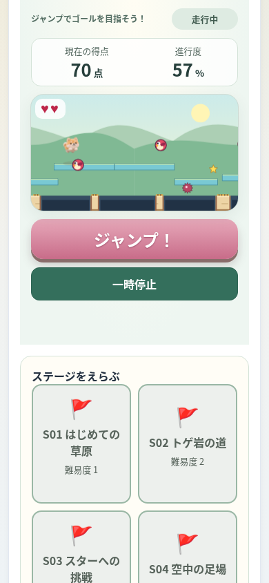 | 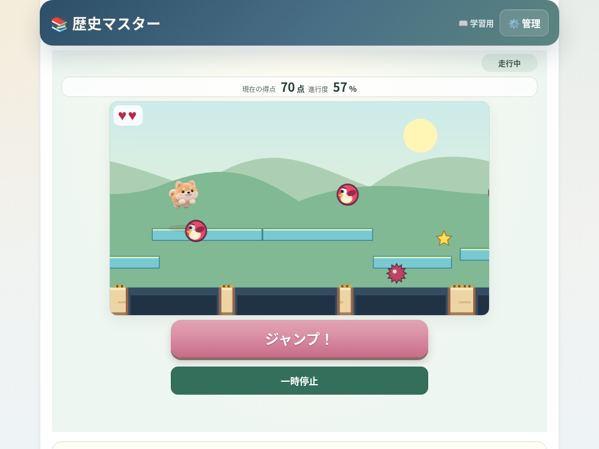 |
| S05 後半 | 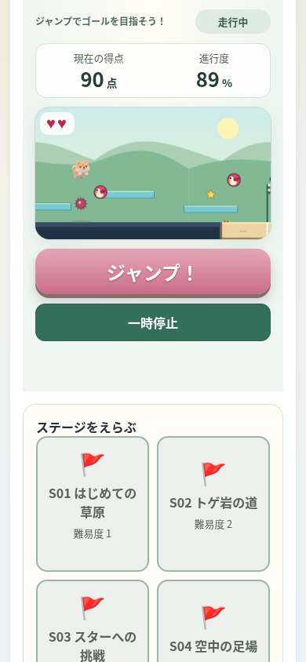 | 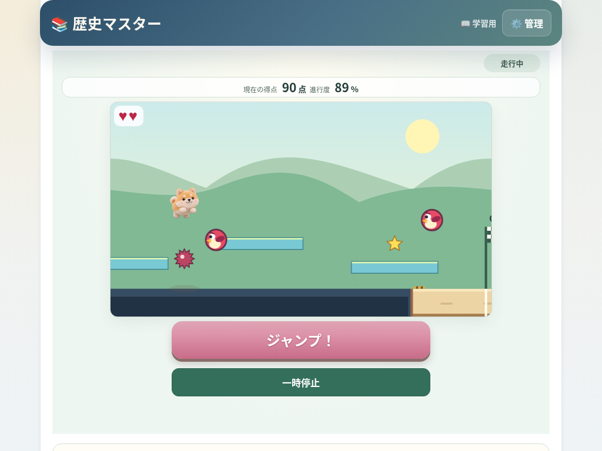 |
| S06 鳥4羽と下段トゲ | 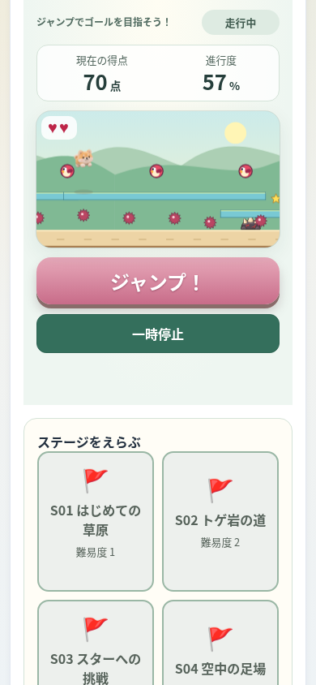 | 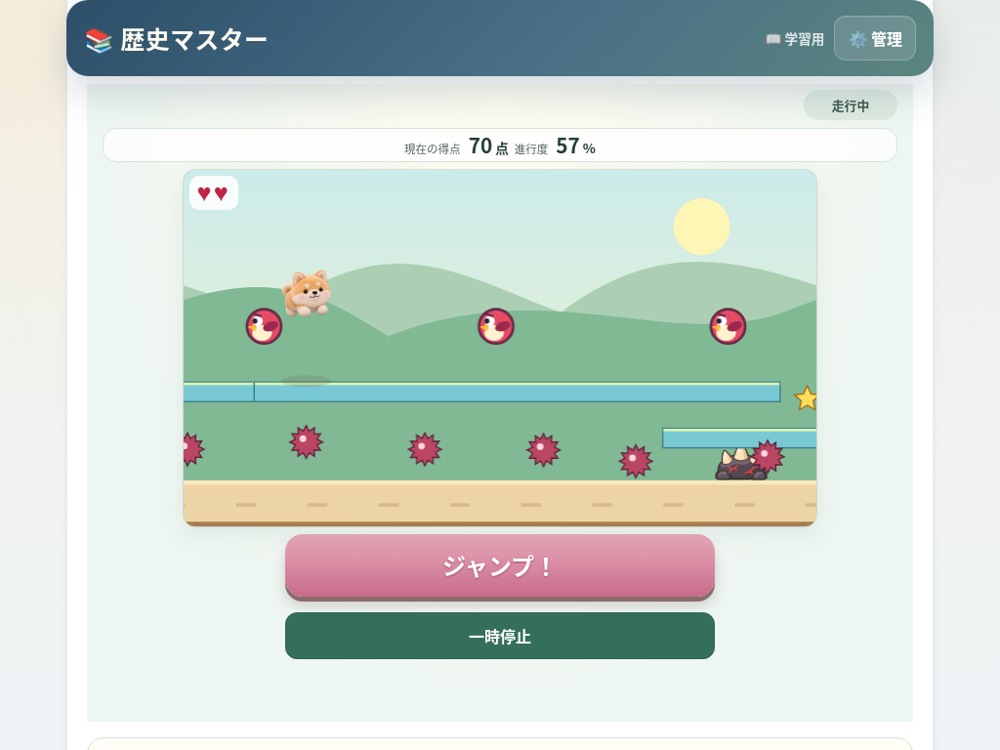 |
| 落下途中 | 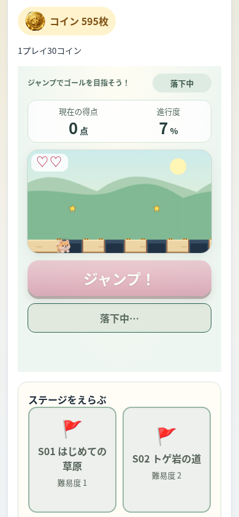 | 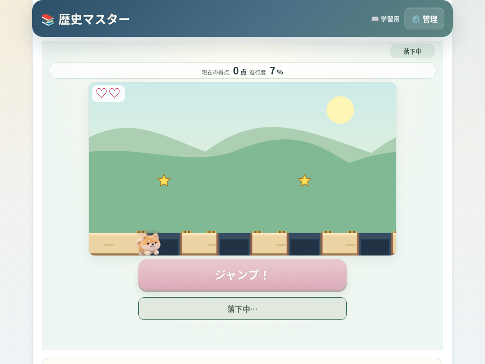 |
| 全身消失・結果前 | 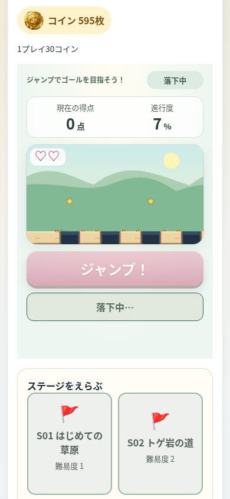 | 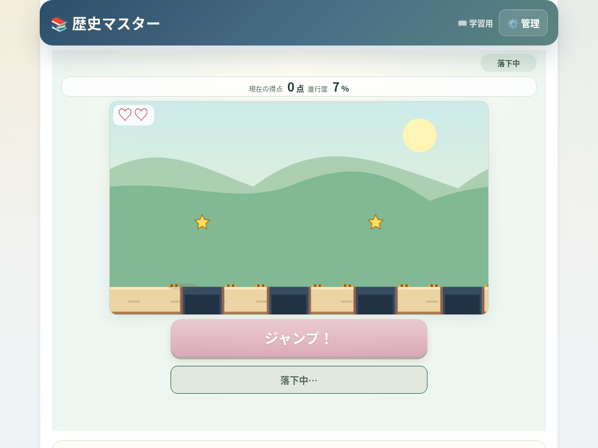 |
| 結果表示 | 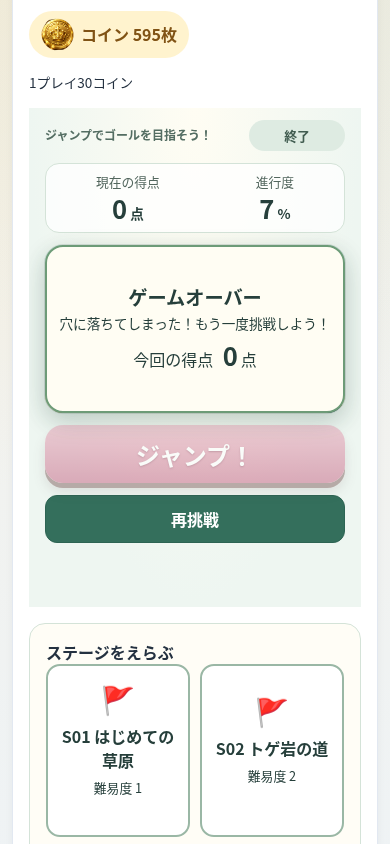 | 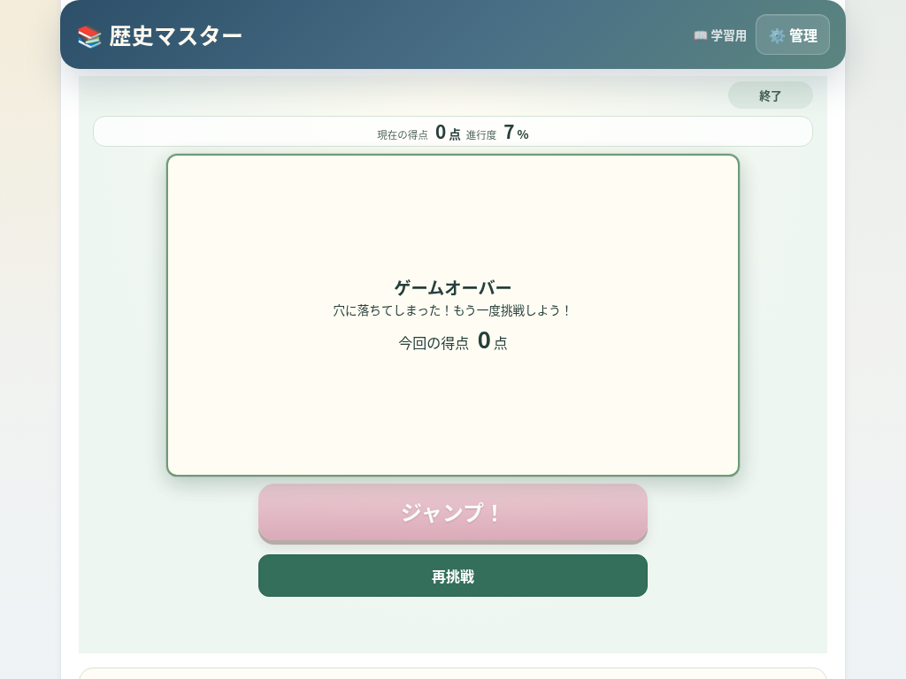 |

[短い落下動画](screenshots/runner-85-balance/fall.mp4) ／ [120Hz表示フレーム記録](screenshots/runner-85-balance/fall-390-frames.json)

## 限定テストと未実施事項

新規コース/互換性7件、落下UI5件、既存最新版購入/互換性と選択UI、旧回復穴・fatal穴物理、親スクロール・正式iframe・保存の関連テストを選択する。CI結果はドラフトPR本文に記録する。全キャラ×全ステージ、学習/UFOのフル回帰は実施しない。

Safari/WebKit/VoiceOver実機は未検証。iPhone/iPad Safariでレビュー時に確認する項目：

- 穴の入口と足場を見てジャンプを入力できること、落下が視覚的に伝わり全身消失前に結果が出ないこと。
- S05の各連続足場とS06の4羽の回避タイミング、着地と下段トゲの見分けやすさ。
- タッチ連打、画面回転、タブ/アプリ非表示・復帰、BFCache、スクロール位置と親の自然なスクロール。
- 保存待ち・通信/保存失敗・再読込・再挑戦で購入済みプレイやコインが重複しないこと。

mainマージ・タグ・本番デプロイ・Issueクローズは行わず、ドラフトPRでレビュー待ちとする。

