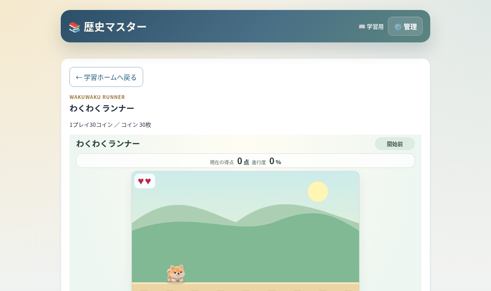
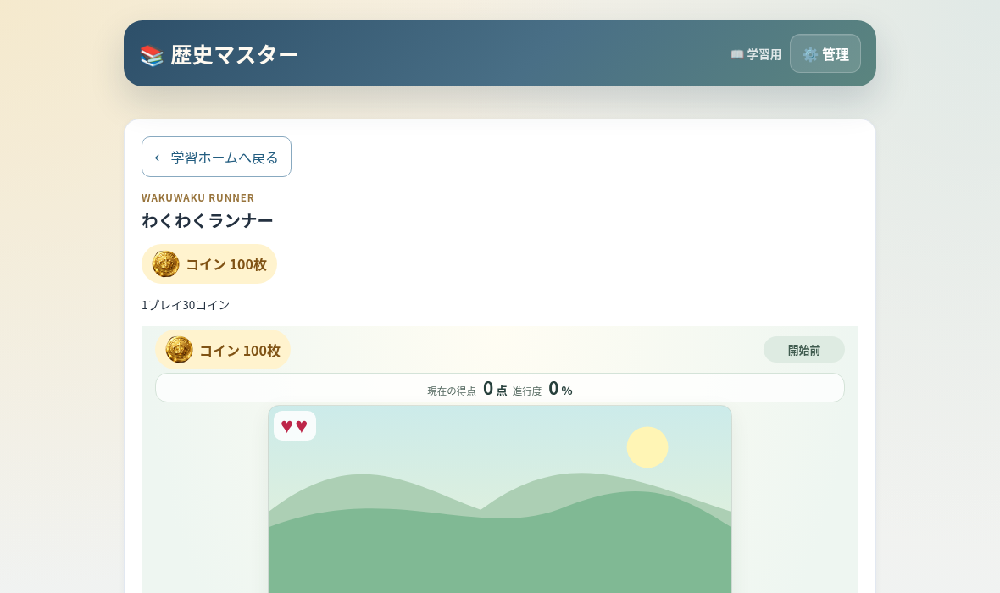
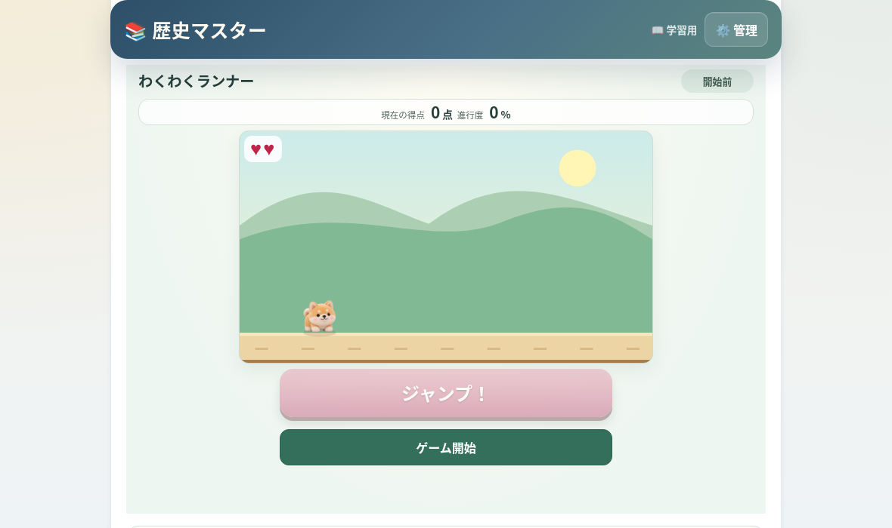
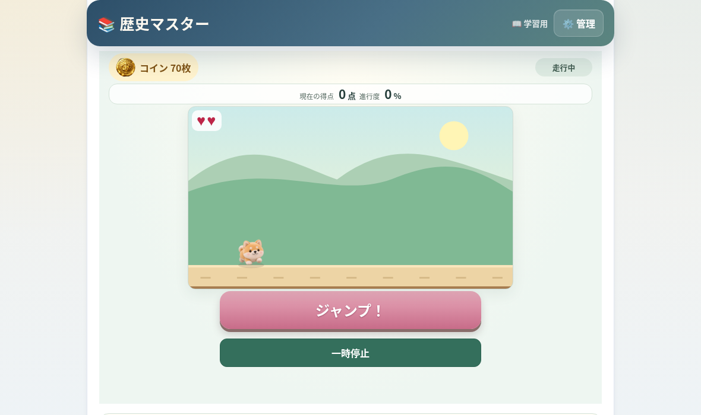
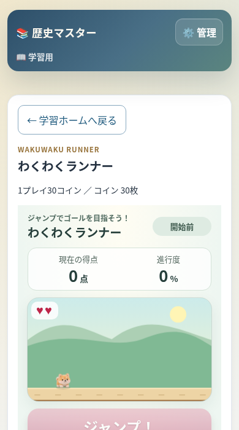
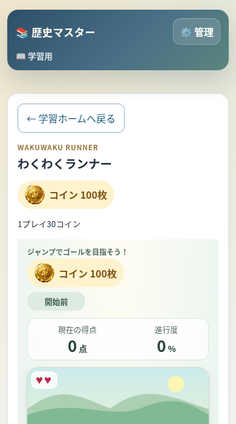
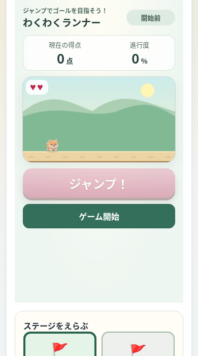
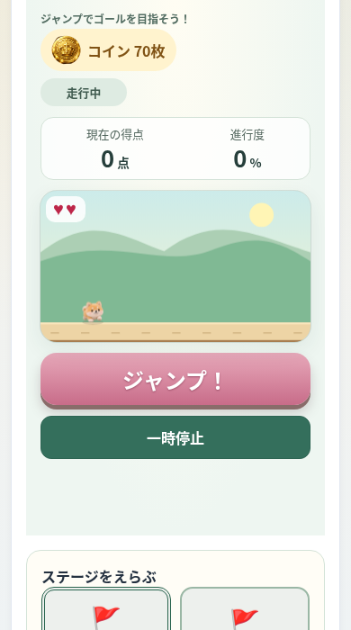

# ランナー残高・タイトル改善（#119 / #118）

基点：origin/main `9ecdfb1`（PR #121反映、v1.7.37）。開始時とPR作成前にfetchし同一を確認。open PRは#1/#30のみで同目的なし。

## 表示と更新

キャッチャーの残高CSSを `runner/balance.css` に共用化。配色・角丸・padding・33px金貨・文字の強弱を共通にする。親見出しの下と子の旧タイトル領域に同じ保存済み残高を表示する。前者はページ先頭への入場、後者はゲームへスクロールした際の確認用。固定・stickyバナーは追加しない。`#runner-info` は料金・保存エラーを維持し、残高の文字重複だけを除く。ホーム紹介の文言は変更しない。

取得は既存 `runnerLobbyData()` のbalance（`getAvailableCoins()`）のみ。親の表示テキストをbridge.view.balanceTextで子へ渡し、子は計算・購入・保存しない。確認中・失敗・テスト無料を明示。入場、購入/キャンセル/再開/無料復帰/再挑戦、プロフィール、focus、visibility、BFCache、storageで照合。IndexedDBの変更はstorageイベントを発火しないので、別タブ更新は復帰イベントで読み直す。要求世代とviewContext、session/savedAt照合で古い読取を棄却し、重なった要求は最後の再取得まで待つ。購入取引も仮減算も変更しない。

正式画面の `#runner-title` のみ1pxクリップで視覚的に隠す。`aria-labelledby`・見出し要素・状態バッジ・headerを残す。Chromiumのアクセシビリティツリーでmainの名前「わくわくランナー」を確認。デモと試遊ではタイトルを従来どおり表示。

## 実測（Chromium、CSS px）

同一合成DB・手動時間制御。入場はDOM clickで実行し、自動スクロール前にscrollY=0と親バッジ可視を検査。その後ユーザーのゲームへのスクロールを明示的に再現。子yはiframe内の座標。全サイズで子scrollTop=0、scrollHeight=innerHeight。生座標は [coordinates.json](runner-header-119-118/coordinates.json)。

| viewport | 子header高 前→後 | Canvas幅×高 前→後 | ジャンプ/開始の子y 前→後 | 親scrollY 前→後 | 親残高y / プレイ残高y（画面座標） |
|---|---|---|---|---|---|
|1180×820|31→47|727×408.94→727×408.94|504.94/584.94→506.94/586.94|238→299|299.17 / 89.97|
|1024×768|31→47|648.88×365→648.88×365|460.94/540.94→462.94/542.94|238→299|299.17 / 89.97|
|1366×1024|31→47|778.66×438→778.66×438|533.94/613.94→535.94/615.94|238→299|299.17 / 89.97|
|1180×700|31→47|545.77×307→545.77×307|402.94/482.94→404.94/484.94|238→299|299.17 / 89.97|
|820×1180|49.08→67|714×401.62→714×401.62|547.41/621.41→565.33/639.33|238→299|299.17 / 117.97|
|390×844|44.95→106|300×168.75→300×168.75|331.41/401.41→392.45/462.45|334→395|309.17 / 31.97|
|390×700|44.95→106|300×168.75→300×168.75|331.41/401.41→392.45/462.45|334→395|309.17 / 31.97|
|844×390|31→47|439.11×247→410.66×231|103.95/177.95→119.95/193.95|238→299|299.17 / 91.97|
|700×900|44.95→67|593.77×334→593.77×334|475.78/545.78→497.83/567.83|238→299|299.17 / 117.97|
|500×700|44.95→106|401.77×226→401.77×226|388.78/458.78→449.83/519.83|312→373|287.17 / 31.97|

iPad横は旧31pxヘッダーが47pxになるため、上下padding各6→4px・行間8→4pxで16pxを確保。Canvas寸法・64pxジャンプ・ボタン間16px・中央縦積み・通知予約は維持。iframe高も697/653/726/595pxで不変。iPhone横はヘッダー増加をCanvasの高さ予算16pxで吸収（16:9維持）。iPhone縦は2行のバッジ領域を予約し、Canvas→ジャンプ12pxを維持。下部空白の別件#117は調整しない。親側に残高行が加わるのでゲームまでの親スクロールは約61px増える。

確認中・失敗・無料・100枚を切り替えても全10サイズのCanvas/操作位置は同一。実走行時は購入済み100→70枚を表示し、状態バッジ「走行中」を確認。全結果状態・保存中/失敗・無料再開でも位置と内部スクロールを検証。

## 画面比較

変更前playは開始前の比較、変更後playは100枚から購入成功し70枚で走行中。すべて合成データ。

### 1180x700 entry

### 1180x700 play

### 390x700 entry

### 390x700 play

## 検証結果

- 変更前：runner_layout_test の全8サイズ・全状態 1件成功（24.938秒）。変更後：同モジュール5件成功（34.457秒）。
- runner_header_test：7件成功。0/29/30/100、購入30のみ、キャンセル、無料テスト、途中再開、保存失敗と無料再開、終了後購入、プロフィール、初回/再照合読取失敗、古い応答、別タブ復帰、キャッチャー残高、全10サイズの座標・文言変化・タイトル・実走行を含む。
- runner_results_test全12件、runner_safari_test全8件、入口/購入回帰2件、app_version_test全9件：計31件成功（93.053秒）。Safariというテスト名もエンジンはChromium。
- 親JS・runner/game.jsの構文、git diff --check成功。コミット済みの版検査とGitHub CIはPR本文に追記。新テストを既存の対象限定CIへ追加。
- 再現：`RUNNER_HEADER_REPORT_DIR=/tmp/runner-header PYTHONPATH=tests python3 -m unittest runner_header_test -v`、`RUNNER_LAYOUT_REPORT_DIR=/tmp/runner-after PYTHONPATH=tests python3 -m unittest runner_layout_test -v`。

## 版・制約と残存リスク

APP_VERSIONと親/子の配信識別子をv1.7.37→v1.7.38に1回更新。DB/backup v10、snapshot v2、課金、能力、物理、ステージ、シークレット条件、iframe構造は変更しない。#111/#114/#117は未実装。Issue #74の選択的検証を適用し、無関係な学習・UFO全回帰、全48攻略、移行・バックアップ全件は省略。

Safari実機・WebKit・VoiceOverは未検証。iPad横の指によるジャンプ連打/誤停止、初回表示、実回転/Split View、アドレスバー伸縮・Safe Area、iPhone縦スクロール、OS文字拡大、背景復帰/履歴、VoiceOverの読み上げ順と重複通知・操作到達を公開前に確認する。ChromiumのアクセシビリティツリーはVoiceOverの代替ではない。極小画面や拡大文字では内容を切らず必要なスクロールを許容する。

未解決の既知の機能不具合なし。実機依存の表示・操作は上記未検証項目が残る。mainマージ・タグ作成・本番デプロイ・Issue手動クローズは行わず、ドラフトPRで停止。
