# Issue #85 高所足場・分岐・上下トゲ：後半の配置改善

S05・S06後半の鳥と足場を再配置し、低い鳥のジャンプ回避・高い鳥の下で待つ・降下後にトゲを越えて登る操作を組み合わせる。基点はmain `5e03a44` / v1.7.47（PR #132マージ済み）。新規購入のS05/S06だけstageVersion 4とし、公開済み版3・S04版5・その他すべての旧コースを保持。APP_VERSIONはv1.7.48へ更新し、親・iframe・CSS/JSの配信識別子を同期。DB/backup v10、snapshot v2は維持する。

## コース全体

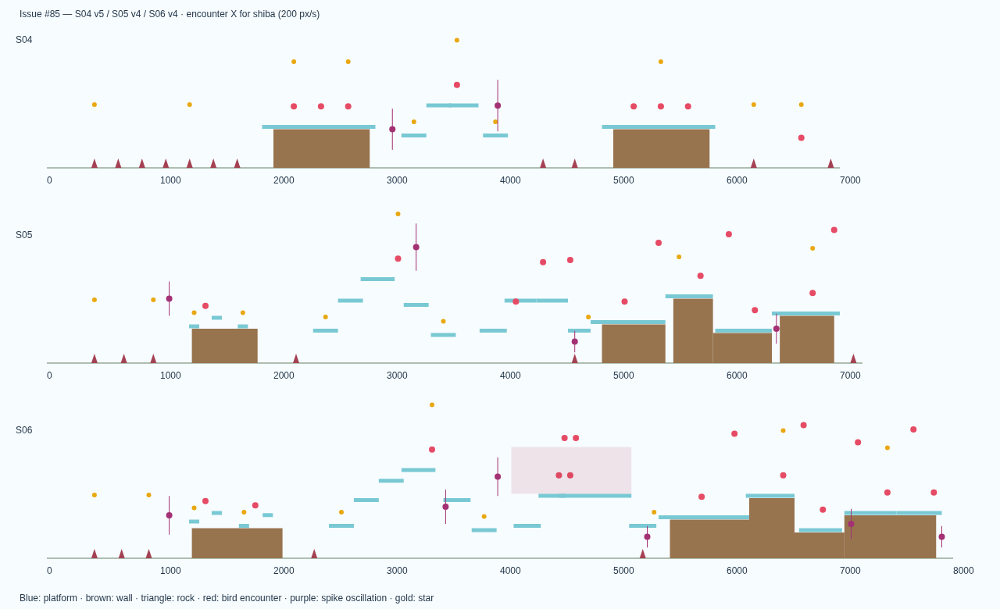

[拡大用SVG](screenshots/runner-85-vertical/course-map.svg)

Xはキャラ中心の通過距離。鳥の遭遇Xはしば犬（200px/s）基準で初期世界X/1.6。別キャラでは遭遇位置・時刻が変わる。スター各10個・100点、距離7000/7200/8000を維持。青い足場・茶色の壁・岩・鳥・上下トゲを区別。カメラ・Canvas960×540・地面Y470・iframe・操作ボタンは変更なし。

## 配置の数値（論理px）

### S04 版5

**鳥（すべて左120px/s、中心Y=470−高度、半径28）**

| # | 初期世界X | しば犬遭遇X | 高度 |
|---|---:|---:|---:|
| 1 | 3488 | 2180 | 143 |
| 2 | 3872 | 2420 | 143 |
| 3 | 4256 | 2660 | 143 |
| 4 | 5792 | 3620 | 193 |
| 5 | 8288 | 5180 | 143 |
| 6 | 8672 | 5420 | 143 |
| 7 | 9056 | 5660 | 143 |
| 8 | 10656 | 6660 | 70 |

**上下トゲ（固定世界X、半径26）**

| X | 基準高度 | 振幅 | 周期（秒） | 位相（rad） |
|---:|---:|---:|---:|---:|
| 3050 | 90 | 48 | 2.4 | 0.4 |
| 3980 | 145 | 60 | 2.8 | 1.2 |

**足場（中心X・幅・高度。端間隔は次の左端−現在の右端、負は重なり）**

| 中心X | 幅 | 高度 | 次への端間隔 |
|---:|---:|---:|---:|
| 2400 | 1000 | 100 | 230 |
| 3240 | 220 | 80 | 0 |
| 3460 | 220 | 150 | -20 |
| 3680 | 260 | 150 | 40 |
| 3960 | 220 | 80 | 830 |
| 5400 | 1000 | 100 | — |

鳥は計8羽、後半1/2に5羽、最後の1/3に4羽。

岩X: 420, 630, 840, 1050, 1260, 1470, 1680, 4380, 4660, 6240, 6920。

壁（左端〜右端・高度）: 2000〜2850 / 90, 5000〜5850 / 90。

### S05 版4

**鳥（すべて左120px/s、中心Y=470−高度、半径28）**

| # | 初期世界X | しば犬遭遇X | 高度 |
|---|---:|---:|---:|
| 1 | 2240 | 1400 | 133 |
| 2 | 4960 | 3100 | 243 |
| 3 | 6624 | 4140 | 143 |
| 4 | 7008 | 4380 | 235 |
| 5 | 7392 | 4620 | 240 |
| 6 | 8160 | 5100 | 143 |
| 7 | 8640 | 5400 | 280 |
| 8 | 9232 | 5770 | 203 |
| 9 | 9632 | 6020 | 300 |
| 10 | 10000 | 6250 | 123 |
| 11 | 10816 | 6760 | 163 |
| 12 | 11120 | 6950 | 310 |

**上下トゲ（固定世界X、半径26）**

| X | 基準高度 | 振幅 | 周期（秒） | 位相（rad） |
|---:|---:|---:|---:|---:|
| 1080 | 150 | 40 | 2.6 | 0.2 |
| 3260 | 270 | 55 | 2.8 | 3.59 |
| 4660 | 50 | 25 | 2.4 | 2 |
| 6440 | 80 | 35 | 2.6 | 0.5 |

**足場（中心X・幅・高度。端間隔は次の左端−現在の右端、負は重なり）**

| 中心X | 幅 | 高度 | 次への端間隔 |
|---:|---:|---:|---:|
| 1300 | 90 | 90 | 110 |
| 1500 | 90 | 110 | 140 |
| 1730 | 90 | 90 | 575 |
| 2460 | 220 | 80 | 0 |
| 2680 | 220 | 150 | -20 |
| 2920 | 300 | 200 | 80 |
| 3260 | 220 | 140 | 20 |
| 3500 | 220 | 70 | 210 |
| 3940 | 240 | 80 | -20 |
| 4180 | 280 | 150 | 0 |
| 4460 | 280 | 150 | 0 |
| 4700 | 200 | 80 | 0 |
| 5130 | 660 | 100 | 0 |
| 5670 | 420 | 160 | 20 |
| 6150 | 500 | 80 | 0 |
| 6700 | 600 | 120 | — |

鳥は計12羽、後半1/2に10羽、最後の1/3に7羽。

岩X: 420, 680, 940, 2200, 4660, 7120。

壁（左端〜右端・高度）: 1280〜1860 / 80, 4900〜5460 / 90, 5530〜5880 / 150, 5880〜6400 / 70, 6470〜6950 / 110。

### S06 版4

**鳥（すべて左120px/s、中心Y=470−高度、半径28）**

| # | 初期世界X | しば犬遭遇X | 高度 |
|---|---:|---:|---:|
| 1 | 2240 | 1400 | 133 |
| 2 | 2944 | 1840 | 123 |
| 3 | 5440 | 3400 | 253 |
| 4 | 7232 | 4520 | 193 |
| 5 | 7312 | 4570 | 280 |
| 6 | 7392 | 4620 | 193 |
| 7 | 7472 | 4670 | 280 |
| 8 | 9248 | 5780 | 143 |
| 9 | 9712 | 6070 | 290 |
| 10 | 10400 | 6500 | 193 |
| 11 | 10688 | 6680 | 310 |
| 12 | 10960 | 6850 | 113 |
| 13 | 11456 | 7160 | 270 |
| 14 | 11872 | 7420 | 153 |
| 15 | 12240 | 7650 | 300 |
| 16 | 12528 | 7830 | 153 |

**上下トゲ（固定世界X、半径26）**

| X | 基準高度 | 振幅 | 周期（秒） | 位相（rad） |
|---:|---:|---:|---:|---:|
| 1080 | 100 | 45 | 2.4 | 0.4 |
| 3520 | 120 | 40 | 2.6 | 1.5 |
| 3980 | 190 | 45 | 2.8 | 0.8 |
| 5300 | 50 | 25 | 2.4 | 2 |
| 7100 | 80 | 35 | 2.8 | 0.4 |
| 7900 | 50 | 25 | 2.6 | 0.5 |

**足場（中心X・幅・高度。端間隔は次の左端−現在の右端、負は重なり）**

| 中心X | 幅 | 高度 | 次への端間隔 |
|---:|---:|---:|---:|
| 1300 | 90 | 90 | 110 |
| 1500 | 90 | 110 | 150 |
| 1740 | 90 | 80 | 120 |
| 1950 | 90 | 105 | 495 |
| 2600 | 220 | 80 | 0 |
| 2820 | 220 | 140 | 0 |
| 3040 | 220 | 185 | -20 |
| 3280 | 300 | 210 | 70 |
| 3620 | 240 | 140 | 10 |
| 3860 | 220 | 70 | 150 |
| 4240 | 240 | 80 | -20 |
| 4460 | 240 | 150 | -60 |
| 4840 | 640 | 150 | -20 |
| 5260 | 240 | 80 | 20 |
| 5800 | 800 | 100 | -30 |
| 6385 | 430 | 150 | 40 |
| 6830 | 380 | 70 | 20 |
| 7270 | 460 | 110 | 0 |
| 7700 | 400 | 110 | — |

鳥は計16羽、後半1/2に13羽、最後の1/3に9羽。

岩X: 420, 660, 900, 2360, 5260。

壁（左端〜右端・高度）: 1280〜2080 / 70, 5500〜6200 / 90, 6200〜6600 / 140, 6600〜7040 / 60, 7040〜7850 / 100。

## 後半で変わる操作

| ステージ | 鳥の遭遇X間隔 | 鳥高度 | 足場高度の順序 |
|---|---|---|---|
| S05 | 300 / 370 / 250 / 230 / 510 / 190px | 143 / 280 / 203 / 300 / 123 / 163 / 310px | 100→160→80→120px |
| S06 | 290 / 430 / 180 / 170 / 310 / 260 / 230 / 180px | 143 / 290 / 193 / 310 / 113 / 270 / 153 / 300 / 153px | 100→150→70→110px |

- S05: 25.05秒に鳥を越え、5400の高い鳥は足場100上を走って下から通す。27.30秒に160へ登り、28.40秒に鳥越え。80の足場へ自然に降り、30.80秒に鳥を越え、31.70秒の着地後31.80秒にトゲ6440を越えて120へ登る。33.35秒に鳥を越え、最後の高い鳥では跳ばず、35.00秒に出口の岩を越える。
- S06: 28.45秒の鳥越え後、6070の高い鳥では跳ばず待ち、30.65秒に150へ登る。32.05秒に鳥を越え、70へ降りる。33.80秒の鳥越え後34.70秒に着地し、34.90秒にトゲ7100を越えて110へ。7160の高い鳥では跳ばず、36.65秒に低い鳥を越える。7650の高い鳥は走って避け、38.60秒に最後の低い鳥とトゲ7900を越える。
- S05で26.55秒、S06で29.90秒に余計なジャンプを加えると、それぞれ5400/6070の高い鳥へ被弾。S05の31.80秒またはS06の34.90秒のジャンプ省略でも被弾する。単なる等間隔ジャンプを配置差として言い換えず、操作変更の必要性を実際の衝突で確認した。

| S05 高い鳥の下で待つ（iPhone / iPad） | S06 トゲを越え次段へ（iPhone / iPad） |
|---|---|
| 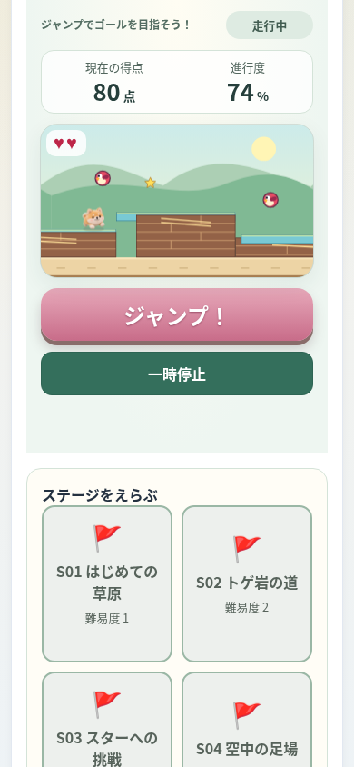 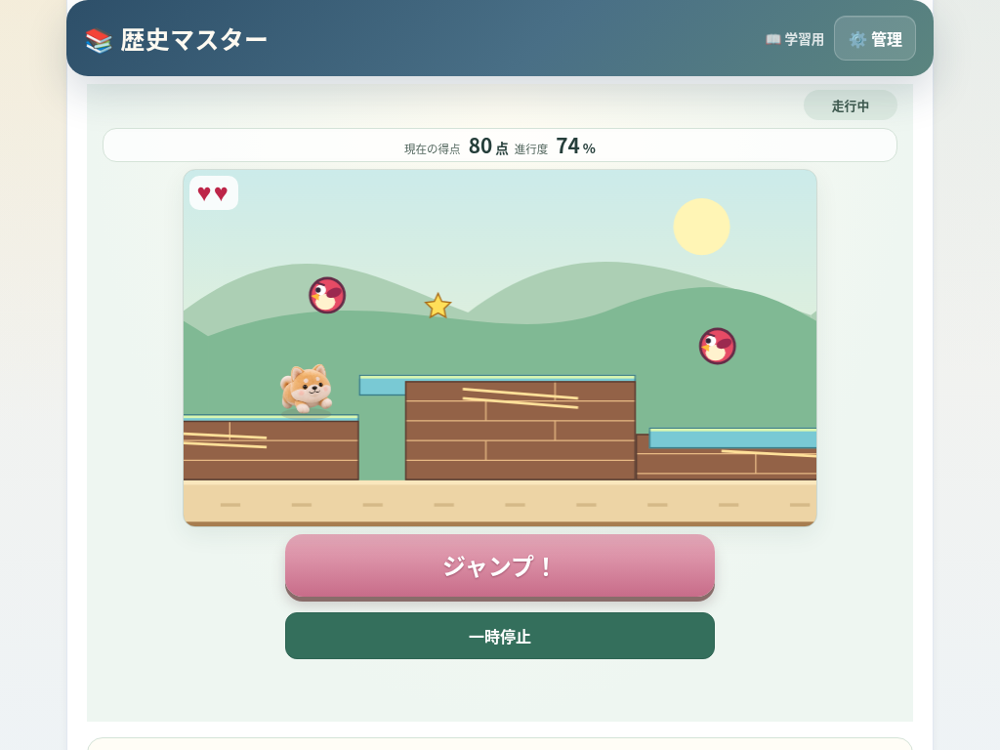 | 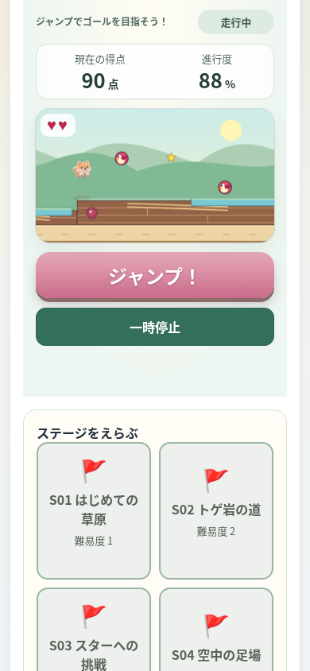 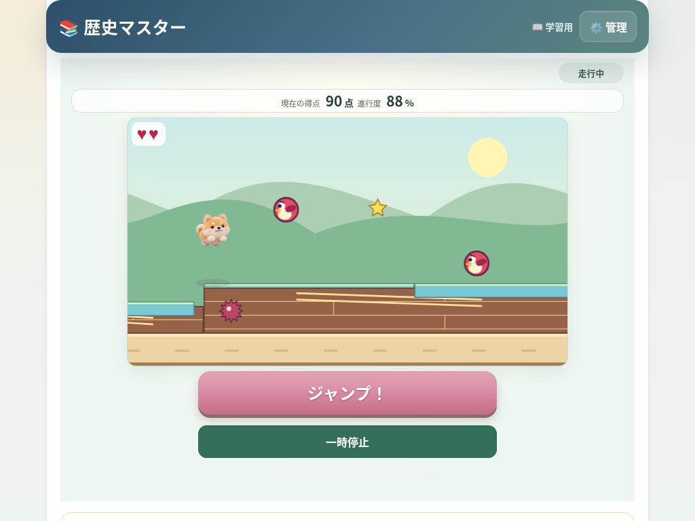 |

## S04 iPhone画像の修正

原因はステージカード選択後の撮影時スクロール位置。親ページscrollY=782のままではゲームが上に外れていた。テスト内だけで手動スクロール相当の移動を行い、scrollY=395で再取得。390×844の親画面内でCanvasのY=136.67〜305.42、ジャンプボタンのY=317.42〜375.42を確認。全撮影時にCanvasとジャンプボタンの可視範囲を検査する。アプリ本体の自動スクロール処理は変更せず、既存の「親スクロール・リサイズで巻き戻らない」テストも成功。

## 高所と分岐の攻略

- S04: 3240の80→3460の150へ順に着地し、上で鳥を越える。3960の80へ自然に降りる。
- S05: 既存1300/1500/1730の短い3足場と地上壁を維持。新規2460/2680/2920で80→150→200へ登り、3260の140→3500の70へ降りる。3940へ登らず走れば下ルート、19.05秒に跳ぶと80→150の上ルート。どちらも無傷100点を確認。
- S06: 既存1300/1500/1740/1950の短い4足場を維持。新規2600/2820/3040/3280で80→140→185→210、3620の140→3860の70へ降りる。20.55秒に跳ぶと4240の80へ上がり、21.65秒に再ジャンプして150の上段へ。跳ばず地上を通る下ルートが無傷の正規経路。
- 高さ候補240は採用せず210へ抑えた。しば犬の最大ジャンプ時、画像全体を覆う91pxの上余白評価でS04=109px、S05=59px、S06=49px。通常キャラ最大ジャンプ160の金魚も最高足場で約10pxを残す。足場高さ＋通常ジャンプ能力から全通常キャラの上端だけを静的確認（全キャラ攻略テストではない）。
- 後半は鳥・足場上の再ジャンプ・上下トゲ・岩を組み合わせる。長い足場/壁は分割し、既存の出現処理で着地前に確実に出現する幅にした。

## S06の鳥の罠と検証の限界

上段には遭遇X=4520/4570/4620/4670、高度193/280/193/280の4羽。低い鳥を跳んで避けると高い鳥に近づき、同高へ戻る0.9秒より短い0.25秒間隔で交互に来る。これは設計意図であり、数学的な回避不能性の証明ではない。下を走ると最も低い鳥でもキャラ中心から約150px離れる。上ルートのみの必須スターはなく、下ルートで全10個を取れる。

分岐前（20.5秒）に右の実際の鳥が見え、上段には薄い警戒色と4羽のシルエットを表示。文字で正解ルートは示さない。通常ジャンプのみで上段を選ぶ必要があり、追加ボタン・透明な壁・専用ダメージ処理は使わない。

通常しば犬、60Hzで入場の2入力を20.2〜20.9秒／21.2〜22.0秒、各0.1秒刻みで変更。上段ジャンプなし、21.9〜23.4秒の単発入力、21.9〜22.5と22.9〜23.5秒の2入力を組み合わせた計1728通り。上段に実際に着地した816通りすべてで鳥による1回以上の被弾を観測。無効な空中入力を含むサンプルもある。離散サンプリングのため、全キャラ・全連続時刻・任意回数入力の完全回避不能性は保証しない。

代表上ルートは30/60/120Hzで100点・残1ハート、代表下ルートは各100点・残2ハート。罠の初被弾は約22.433秒・X4486.7。位置やジャンプを戻さず既存1秒無敵で継続し、正式結果へ保存。被弾直後に保存・開き直しも検証。

## 代表しば犬の入力（開始からのゲーム内秒）

- S04 正規経路: 1.65, 2.7, 3.75, 4.8, 5.85, 6.9, 7.95, 9, 10.45, 11.65, 12.85, 15.6, 16.5, 17.65, 21.45, 22.85, 24, 25.45, 26.65, 27.85, 30.75, 32.85, 34.15
- S05 正規経路: 1.65, 2.95, 4.25, 5.825, 6.65, 7.7, 8.8, 10.55, 11.7, 12.65, 13.75, 15.05, 22.85, 24, 25.05, 27.3, 28.4, 30.8, 31.8, 33.35, 35
- S06 正規経路: 1.65, 2.85, 4.05, 5.825, 6.65, 7.7, 8.85, 9.85, 11.35, 12.4, 13.35, 14.3, 15.2, 16.55, 25.85, 26.8, 28.45, 30.65, 32.05, 33.8, 34.9, 36.65, 38.6
- S05 上経路: 1.65, 2.95, 4.25, 5.825, 6.65, 7.7, 8.8, 10.55, 11.7, 12.65, 13.75, 15.05, 19.05, 20.1, 21.45, 22.65, 24, 25.05, 27.3, 28.4, 30.8, 31.8, 33.35, 35
- S06 上経路: 1.65, 2.85, 4.05, 5.825, 6.65, 7.7, 8.85, 9.85, 11.35, 12.4, 13.35, 14.3, 15.2, 16.55, 20.55, 21.65, 25.85, 26.95, 28.45, 30.65, 32.05, 33.8, 34.9, 36.65, 38.6

入力は開始・通常ジャンプだけ。座標・ハート・無敵・elapsedの補正はしない。主要入力は1つだけ1/60秒刻みで前後に動かし、他の入力は固定して、全入力受理・最高段への着地・無傷100点で連続成功する範囲を測定。全入力同時の変動を保証しない。測定表は後述。

## 保存互換性

DB v10、backup v10、snapshot v2、schemaVersion 1を維持。snapshotのキー・objects型・検査条件は無変更。spikes/routeWarningsは新コース定義からcreate/restore時に復元し、保存しない。`spikeCenter` の `Y=470−height−amplitude×sin(2π×elapsed/period+phase)` を描画と衝突で共有。鳥も既存birdCenterを共有。実時間・乱数・フレーム数に依存せず、停止中のelapsedは進まない。

S04版1〜5、S05/S06版1〜3、S01〜S03全定義を保持。購入時のID/版で取得し、新規購入はS04版5・S05/S06版4。削除・変換・再課金・データ移行なし。基点v1.7.46の独立エンジンによる18状態に加え、v1.7.47の独立エンジンでS05/S06版3の後半を含む12状態とS04版5・S05/S06版3の定義を合成したfixtureを比較。過去PRの旧fixtureも継続。旧版と新版のactiveが混在するbackupをJSON往復・一時DB復元し全ストア一致、両版の再開・再読込後の鳥とトゲ位置を確認。版3→版4への推測変換はしない。

## 実画面（localhost・合成データ・一時Chromium）

Safari実機の画像ではない。正式購入30コイン・実iframe・pointerdownで取得。

| S04 iPhone縦390×844 | iPad横1024×768 |
|---|---|
|  | 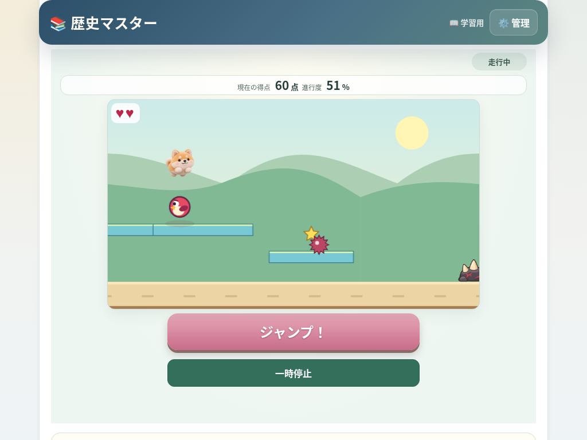 |

| S05 iPhone縦390×844 | iPad横1024×768 |
|---|---|
| 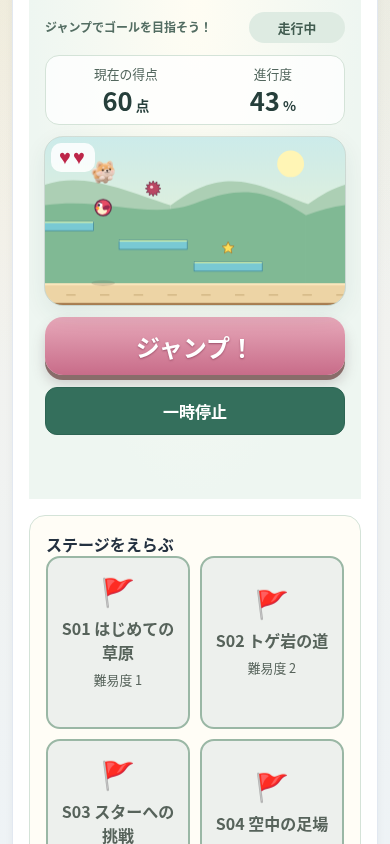 | 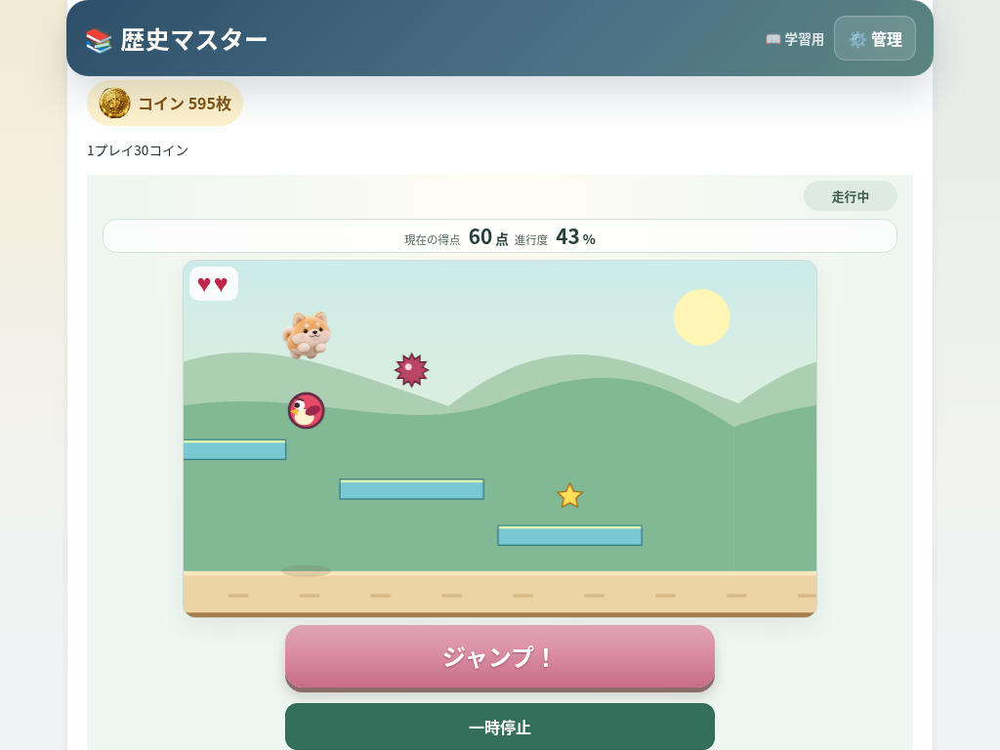 |

| S06 iPhone縦390×844 | iPad横1024×768 |
|---|---|
| 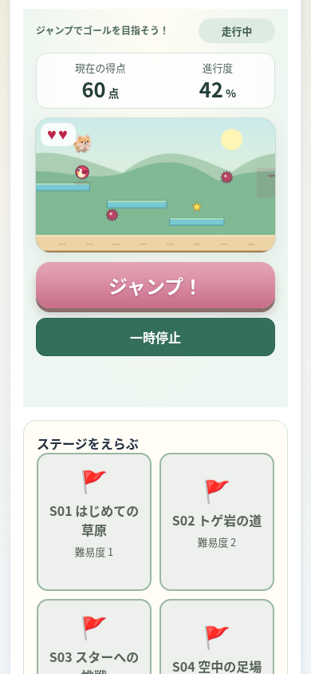 | 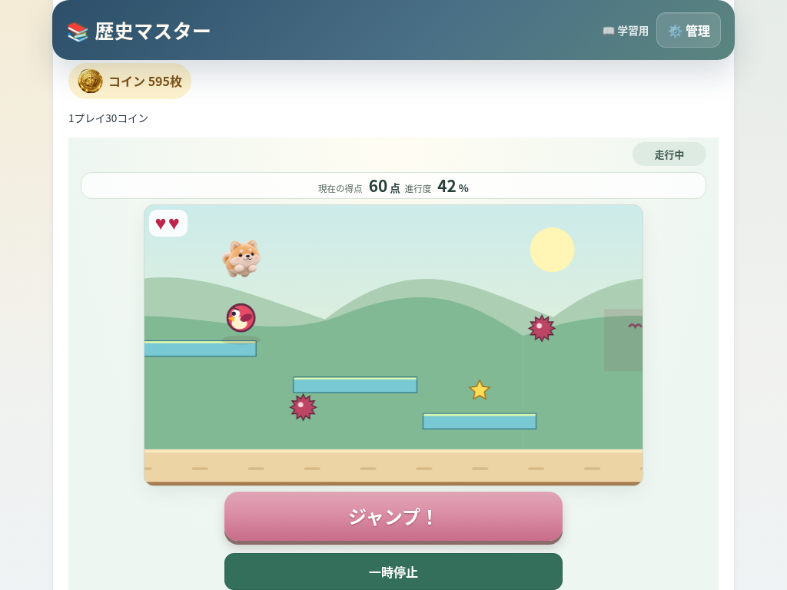 |

| S06 choice iPhone | iPad |
|---|---|
| 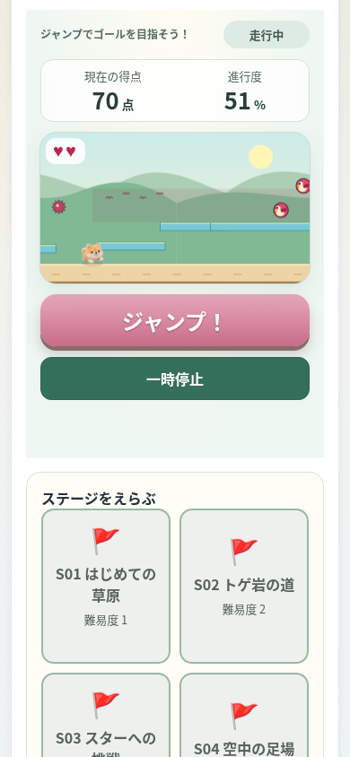 | 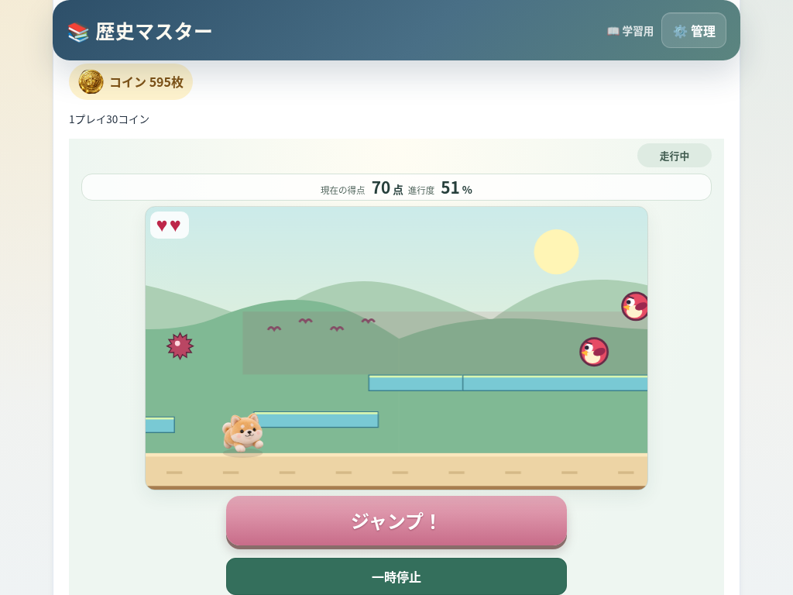 |

| S06 trap iPhone | iPad |
|---|---|
| 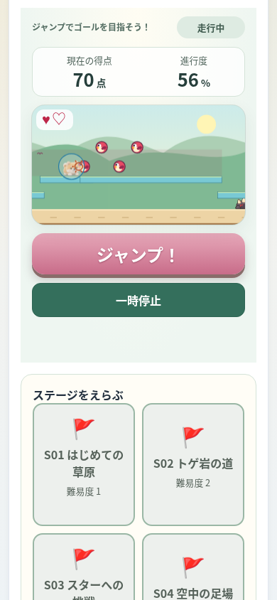 | 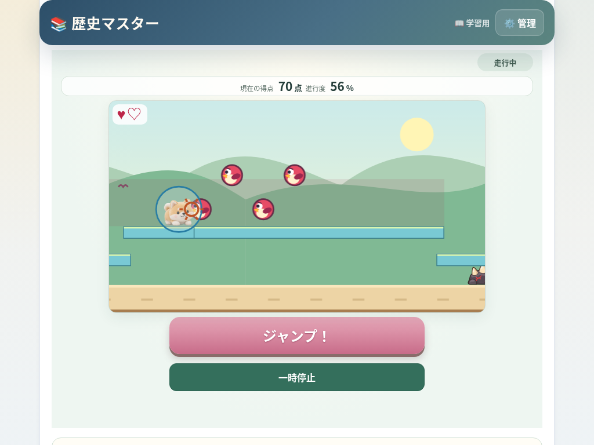 |

| S06 lower iPhone | iPad |
|---|---|
| 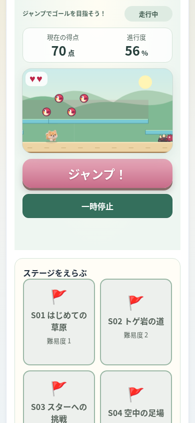 | 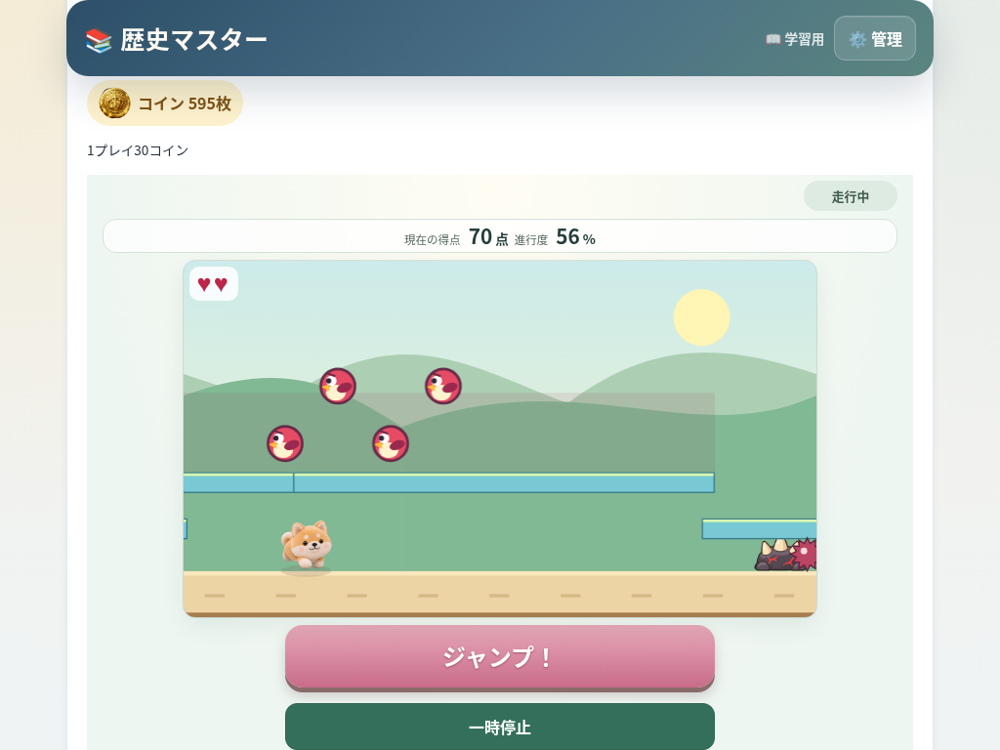 |

## 限定テスト・CI

v1.7.48で関連53件を126.1秒で実行し、すべて成功。以前成功した限定15件に、必要な回帰38件を追加した（重複再実行は計数外）。

- vertical 13件：代表しば犬の正規ルート100点・無傷、上ルートと鳥の罠、30/60/120Hz、全主要入力幅、毎フレームの保存・復元・次軌道一致、旧購入済み18状態、公開済み版3の12状態、版3/4混在バックアップ、正式30コイン購入・保存・結果、iPhone/iPadのCanvasとジャンプ同時表示。
- 最新版選択UIと既存の親スクロール・リサイズ維持の2件も成功。新たな後半操作テストで「余計なジャンプは高い鳥に被弾」「着地後の次ジャンプ省略はトゲ/壁に被弾」を確認。
- 追加回帰38件：旧phase1購入互換5、phase2a購入互換4、tuning購入互換4、density購入互換4、最新版の正式画面入力1、session 11、storage 9。旧版の途中保存・正確な再開・履歴維持、新規購入と30コイン消費、結果/最高点、混在バックアップ復元を確認。
- 主要入力の最小連続成功幅：S04 0.300秒、S05 0.233秒、S06 0.217秒。入力1つだけを1/60秒刻みで変え、他の入力は固定した結果。全入力同時の変動は保証しない。
- 親script・game・stagesの構文、差分空白検査成功。APP_VERSION v1.7.47→v1.7.48、配信識別子を同期。アプリ本体のスクロールコード・物理コードは変更なし。
- CI結果は新しいドラフトPRに記載。前回PR #132の成功結果を今回の結果として扱わない。

全キャラ×全ステージ攻略・学習/UFOのフル回帰・Safari実機は省略。

## Safari実機で未検証の項目

1. iPhone縦・iPad横で高所の足元・鳥の群れ・上下トゲ・上下分岐の視認性と、子どもの実操作での入力猶予・難易度。
2. 上段でのジャンプ・下段選択・鳥の被弾時にタップが通り、ページスクロールや回転後もボタン・画面が欠けないこと。
3. トゲの頂点・鳥接近・高所足場上・無敵中の停止、アプリ切替、回転、BFCache、再読込後の位置と手動再開。
4. 旧購入の追加課金なし再開、コイン・最高点・混在バックアップを安全なテスト端末で確認。

ページ破棄直前の未確定チェックポイント、旧アプリへのダウングレード、新コースの全キャラ攻略は保証しない。mainマージ・タグ・本番デプロイを行わず、ドラフトPRでレビュー待ち。

## 主要ジャンプの成功幅（60Hz）

| ステージ | 基準入力秒 | 成功区間秒 | 連続幅秒 |
|---|---:|---|---:|
| S04 | 1.65 | 1.483〜1.800 | 0.317 |
| S04 | 2.7 | 2.550〜2.850 | 0.300 |
| S04 | 3.75 | 3.600〜3.900 | 0.300 |
| S04 | 4.8 | 4.650〜4.950 | 0.300 |
| S04 | 5.85 | 5.700〜6.000 | 0.300 |
| S04 | 6.9 | 6.750〜7.050 | 0.300 |
| S04 | 7.95 | 7.800〜8.100 | 0.300 |
| S04 | 9 | 8.850〜9.400 | 0.550 |
| S04 | 10.45 | 10.217〜10.683 | 0.467 |
| S04 | 11.65 | 11.417〜11.883 | 0.467 |
| S04 | 12.85 | 12.617〜13.083 | 0.467 |
| S04 | 15.6 | 15.467〜15.783 | 0.317 |
| S04 | 16.5 | 16.317〜16.833 | 0.517 |
| S04 | 17.65 | 17.417〜17.883 | 0.467 |
| S04 | 21.45 | 21.283〜21.617 | 0.333 |
| S04 | 22.85 | 22.683〜23.017 | 0.333 |
| S04 | 24 | 23.767〜24.400 | 0.633 |
| S04 | 25.45 | 25.217〜25.683 | 0.467 |
| S04 | 26.65 | 26.417〜26.883 | 0.467 |
| S04 | 27.85 | 27.617〜28.083 | 0.467 |
| S04 | 30.75 | 30.583〜30.917 | 0.333 |
| S04 | 32.85 | 32.683〜33.017 | 0.333 |
| S04 | 34.15 | 33.983〜34.317 | 0.333 |
| S05 | 1.65 | 1.483〜1.817 | 0.333 |
| S05 | 2.95 | 2.783〜3.117 | 0.333 |
| S05 | 4.25 | 4.083〜4.417 | 0.333 |
| S05 | 5.825 | 5.508〜5.958 | 0.450 |
| S05 | 6.65 | 6.517〜6.783 | 0.267 |
| S05 | 7.7 | 7.517〜7.817 | 0.300 |
| S05 | 8.8 | 8.650〜8.967 | 0.317 |
| S05 | 10.55 | 10.383〜10.717 | 0.333 |
| S05 | 11.7 | 11.450〜11.933 | 0.483 |
| S05 | 12.65 | 12.417〜12.933 | 0.517 |
| S05 | 13.75 | 13.400〜14.033 | 0.633 |
| S05 | 15.05 | 14.817〜15.267 | 0.450 |
| S05 | 22.85 | 22.450〜23.017 | 0.567 |
| S05 | 24 | 23.667〜24.083 | 0.417 |
| S05 | 25.05 | 24.867〜25.283 | 0.417 |
| S05 | 27.3 | 27.067〜27.383 | 0.317 |
| S05 | 28.4 | 28.167〜28.633 | 0.467 |
| S05 | 30.8 | 30.567〜30.900 | 0.333 |
| S05 | 31.8 | 31.700〜31.933 | 0.233 |
| S05 | 33.35 | 33.117〜33.583 | 0.467 |
| S05 | 35 | 34.800〜35.083 | 0.283 |
| S06 | 1.65 | 1.483〜1.817 | 0.333 |
| S06 | 2.85 | 2.683〜3.017 | 0.333 |
| S06 | 4.05 | 3.883〜4.217 | 0.333 |
| S06 | 5.825 | 5.525〜5.958 | 0.433 |
| S06 | 6.65 | 6.517〜6.783 | 0.267 |
| S06 | 7.7 | 7.517〜7.817 | 0.300 |
| S06 | 8.85 | 8.667〜8.983 | 0.317 |
| S06 | 9.85 | 9.717〜10.067 | 0.350 |
| S06 | 11.35 | 11.183〜11.500 | 0.317 |
| S06 | 12.4 | 12.250〜12.633 | 0.383 |
| S06 | 13.35 | 13.117〜13.517 | 0.400 |
| S06 | 14.3 | 14.133〜14.383 | 0.250 |
| S06 | 15.2 | 15.117〜15.600 | 0.483 |
| S06 | 16.55 | 16.400〜16.783 | 0.383 |
| S06 | 25.85 | 25.800〜26.017 | 0.217 |
| S06 | 26.8 | 26.567〜26.983 | 0.417 |
| S06 | 28.45 | 28.217〜28.683 | 0.467 |
| S06 | 30.65 | 30.250〜30.850 | 0.600 |
| S06 | 32.05 | 31.817〜32.283 | 0.467 |
| S06 | 33.8 | 33.567〜34.000 | 0.433 |
| S06 | 34.9 | 34.700〜35.067 | 0.367 |
| S06 | 36.65 | 36.417〜36.883 | 0.467 |
| S06 | 38.6 | 38.467〜38.683 | 0.217 |
