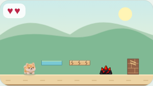
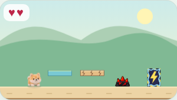
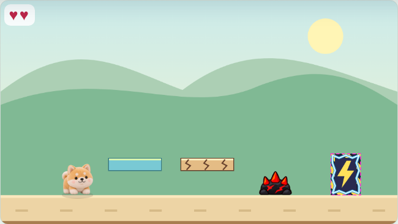

# Issue #137：壁を電撃ブロックへ

基準はPR #140マージ済みmain `d2d2f431afc5f467a3cc1def8e671558b6522eca`（v1.7.53）。提案版はv1.7.54。

## 描画の変更

`drawWall()` のみを濃紺の本体・大きな黄色の稲妻・黄黒の警戒模様・青白い静止した放電へ変更する。放電は上面・両側面・底面に沿わせ、全面接触が危険なことを示す。点滅や外部アセットは追加しない。長い壁は稲妻を繰り返し、細い壁は縦横に合わせる。

### 変更前・変更後と4種類の比較

左から通常足場・崩れる足場・PR #140の赤いトゲ岩・今回の壁。テスト専用の合成配置を実iframeのCanvasに描画し、CSS原寸で撮影した。コースの配置は変更していない。

| 表示 | 変更前 | 変更後 |
| --- | --- | --- |
| iPhone縦390×844 |  |  |
| iPhone横844×390 | [変更前](before-844x390-canvas.png) | [変更後](after-844x390-canvas.png) |
| iPad横1024×768 | [変更前](before-1024x768-canvas.png) | [変更後](after-1024x768-canvas.png) |

72×100論理pxの見本壁はiPhone縦で22.5×31.25 CSS px。稲妻と明るい外周が残る。小学生による初見識別評価は未実施。

[実Canvas寸法](canvas-metrics.json) / [細い壁・高い壁・長い壁の原寸見本](wall-sizes.png)

## 実ゲーム画面

テストプロフィールの正式セッションを通常の開始・ジャンプ・advance・停止でS05の5.5秒まで進めて撮影。合成データのみを使用し、コース・物理状態の置換はしていない。画面サイズを変えた後もタッチジャンプ・停止・再開が動作することを確認した。S01には壁がないため、壁が現れるS05を撮影した。

- [iPhone縦390×844](game-s05-390x844.png)
- [iPhone横844×390](game-s05-844x390.png)
- [iPad横1024×768](game-s05-1024x768.png)

## 判定・既存仕様



紫の点線は `wallBounds()` の同一座標。装飾はクリップで矩形内に収め、上辺・側辺も空白にしない。24種類の既存壁サイズ（全コース版から列挙）の画素検査で矩形外alpha>0は0、内部alpha<255も0。Canvas変換の復元も確認。[画素検査](paint-metrics.json)

- `wallBounds()`、`touchesObject()`、ジャンプ物理、配置・寸法・コース全版・stageVersion・ハート・S01〜S06難易度は変更なし。
- game.jsからdrawWallと配信クエリを除いた本文は基準mainと一致。stages.jsと赤いトゲ岩のWebPも基準mainとバイト一致。
- 通常・崩れる足場と赤いトゲ岩をそれぞれ旧新モジュールで描画したCanvasの画素は一致。トゲ岩の画像・フォールバックは変更なし。
- DB v10・backup v10・snapshot v2、購入・途中再開の処理に差分なし。強制終了は未対応のまま。
- APP_VERSION、親import・iframe URL・子JS/CSS/importを1.7.54へ同期。変更のないトゲ岩WebPは既存の `?v=1.7.53` を維持する。

## 限定テスト

Issue #74の選択的テスト方針で実施。自動検証はChromium。

- 新規 `RunnerWallDesignTest` 3件成功（初回11.113秒。撮影と見本画像調整後は対象2件を含む3件7.627秒、その後撮影1件を再実行）。全24サイズの描画範囲・不透明性、他の障害物画素、iframeでの3画面サイズ・タッチ・回転、基準mainの物理比較を検証。
- S01/S05/S06 × 30/60/120Hz × 回避/無操作衝突＝18経路で、**最新mainと全フレームsnapshot v2のSHA-256・最終結果・距離・フレーム数が一致**。回避9経路は100点・2ハート、衝突9経路はcollision・0ハート。各ステージの終了理由・得点・残ハートも30/60/120Hz間で一致。[旧新の物理結果](physics-results.json)
- 既存 `RunnerDifficultyTest` の壁3件成功：上面・側面の境界接触はハート1減、境界外は0減、上面着地で足場化しない、無敵中の重複ダメージなし、描画カリングと寸法。
- `RunnerSessionTest` 11件成功：購入・無料・既存購入済み保持・旧snapshot・保存再開・backup v10・プロフィール分離・結果の整合。
- `RunnerIntegrationTest.test_home_formal_purchase_reload_resume_return` 成功：正式購入→再読込→再開で追加課金なし。
- 18件を選択実行して17件成功、既存の壁描画テストは旧茶色への依存を更新し、テストモジュールの空のelseを修正して単独再実行成功。アプリ側への修正追加はなし。
- 親JS/game.js構文・差分空白チェック成功。コミット済み版検査とCIの結果・リンクはPR本文に記載する。
- CIには新規3件と既存壁3件を追加。既存のCI項目は維持する。

```sh
PYTHONPATH=tests python3 -m unittest -v runner_wall_design_test
```

画像は既定 `/tmp/runner-137-wall` に生成する。`RUNNER_WALL_REVIEW` で変更可能。変更前のコードはテストで固定SHAから取得するため、Git履歴が必要（CIはfetch-depth: 0）。

## Safari実機での確認事項

Safari/WebKit実機、VoiceOver、小学生の初見評価は未実施。マージ・本番配信前のレビュー環境で以下を確認する。

1. iPhone縦で稲妻・警戒模様・上面と側面の放電を認識でき、青い足場・茶色の崩れる足場・赤いトゲ岩と区別できるか。
2. iPhone縦横回転・iPad横・アドレスバー変動後も、壁の接地と上辺/側辺、ジャンプ/停止/再開のタッチ操作が自然か。
3. 上面・側面接触で1ハート減り、飛び越えれば減らず、放電が判定矩形の外に見えないか。静止表示で眩しすぎないか。
4. 更新後にv1.7.54のJSが取得され、購入済みプレイを追加料金なしで再開できるか。

全キャラ×全ステージ攻略、学習・UFO・問題機能の全面回帰は範囲外として未実施。

Refs #137。強制終了ボタンは残るのでIssueはクローズしない。ドラフトPRで停止し、mainマージ・タグ作成・本番デプロイは行わない。
