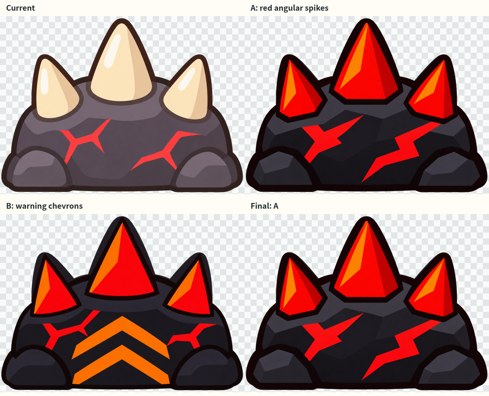
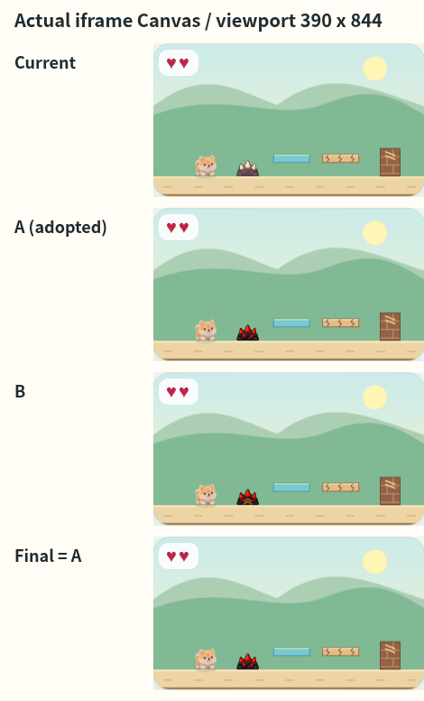
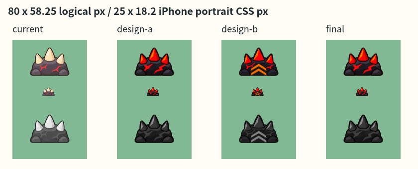
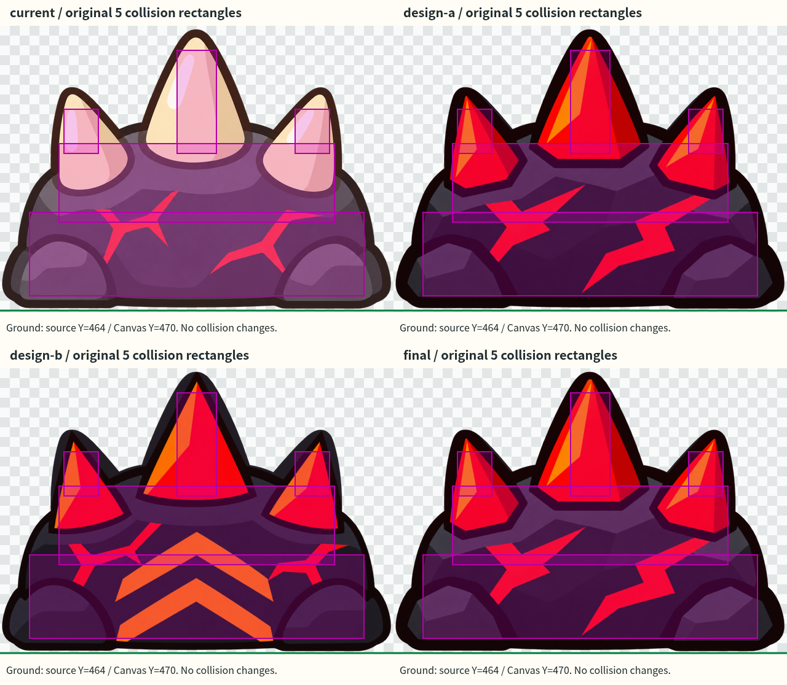
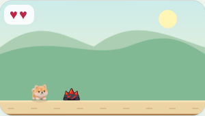

# Issue #137① トゲ岩の視認性レビュー

基準: main `cebbfd6f405ccee648bd70ed7122bae0cb2b4d03` / v1.7.52（PR #139マージ済み）。提案版 v1.7.53。①の共通描画だけを変更し、②全ステージ解放・③強制終了は変更しない。

## 比較と採用理由

[旧画像](current.webp) / [案A](design-a.webp) / [案B](design-b.webp) / [採用画像＝A](../../../runner/assets/spike-rock.webp)



案Aは赤い鋭角の3本トゲ、橙の面、大きな稲妻状の亀裂、暗い岩と太い輪郭。案Bは赤いトゲに橙の警戒山形模様を追加した案。

iPhone縦でのトゲ岩は約25×18.2 CSS px。案Aは3つの尖った赤い面と左右の亀裂が分離して見え、トゲへ視線を誘導できる。案Bも危険色は明瞭だが、下部の山形模様が目立ち、上向き矢印や足場のようにも解釈し得るため、案Aを採用した。子どもによる認知テストやSafari実機での評価は未実施。



[横844×390の比較](comparison-844x390.png) / [iPad横1024×768の比較](comparison-1024x768.png)

比較表には実iframeのCanvasスクリーンショットを拡縮せず配置した。各行は旧・A・B・最終の順。岩・青足場・茶色の崩れる足場・壁の左から順に並ぶ。比較専用の合成状態をテスト内の `renderScene()` に渡しており、本番のコースや配置は変更していない。青足場と崩れる足場の上面は水平で、壁はレンガ状。トゲ岩だけが3本の赤い鋭角を持つ。

| 親画面 | 実Canvas CSS寸法 | トゲ岩 CSS幅 |
| --- | --- | --- |
| iPhone縦390×844 | 300×168.75 | 25 |
| iPhone横844×390 | 約439.11×247 | 約36.59 |
| iPad横1024×768 | 約648.88×365 | 約54.07 |

数値は [canvas-metrics.json](canvas-metrics.json)。画像閲覧アプリの自動縮小・拡大とCSS原寸は別なので、表の画像を原寸でも確認する。



グレースケールでも3本の先端と暗い外縁を確認。危険色だけに依存せず、尖った赤い面と大きな亀裂で表現する。警告文字・細線・点滅は追加していない。

## 実ゲーム画面

実ステージS01の正式セッションを通常のジャンプ・advance・停止で3.25秒まで進めた画面。テスト用プロフィール・合成データだけを使用。ゲーム画面が見える位置へ撮影時にスクロールした。

- [iPhone縦390×844](game-s01-390x844.png)
- [iPhone横844×390](game-s01-844x390.png)
- [iPad横1024×768](game-s01-1024x768.png)

並列見本と実操作UIの全景: [iPhone縦](iphone-390x844.png) / [iPhone横](iphone-844x390.png) / [iPad横](ipad-1024x768.png)。

## 形状・透過・当たり判定



紫は既存の `COLLISION.obstacleRegions`、緑はソースY=464の接地線（Canvas Y=470）。重ね合わせは4案とも同じ座標。矩形の先端と見た目の先端の既存の内側余裕も維持した。

- 旧・A・B・最終はすべて640×466、RGBA WebP。
- alpha>0の外接範囲は全案 `[1,3,638,464)`。下端2行は透明。
- **全298,240画素で旧画像とalphaが完全一致**。元画像の透過マスクをそのまま使用したため、透明な場所に判定が出たり、実体が新しく判定外へ突出したりしない。
- 5矩形の最小alphaは順に253 / 253 / 253 / 252 / 253。旧と同じで透明穴なし。
- `OBSTACLE_IMAGE.width=80`, `height=58.25`, `feetRatio=464/466`、描画上端Y=412、接地Y=470、すべて維持。
- 配信WebPは162,968→132,906 bytes（約18%減）。[画素検査結果](image-metrics.json)。

制作は既存の許可済みトゲ岩を参照した画像生成によるオリジナル2案。配信用にImageMagickで640×466へ寸法を正規化し、元WebPのalphaをCopyOpacityで適用、lossless WebPで保存した。外部素材転載・新しい有料サービス・ランタイム依存は追加していない。最終は `design-a.webp` と同じバイト列。

## 画像404時



実際の画像URLを404にし、iframeを再生成して確認。フォールバックも赤い鋭角3本トゲ・橙の面・大きな赤い亀裂を持つ。同じ描画矩形／足元基準を使用。5矩形内の不透明性、3本の危険色、ジャンプ入力、衝突、ゲームオーバー保存を検証した。既存テストでは404の回避・衝突・再挑戦も成功。

キャッシュは画像URL `spike-rock.webp?v=1.7.53` で旧URLと区別。親APP_VERSION、親のimport、iframe URL、子JS/CSS、子のimportも1.7.53に統一。変更前のページを開き続けている場合の強制更新は行わず、更新後の親ページから取得する配信系列をそろえる。

## 限定テスト

Issue #74の選択的テスト方針で実行。

- `runner_spike_design_test` 新規4件成功（最終通し13.332秒）。撮影条件調整後の404テストも再実行成功。
- 変更前mainの実モジュールで記録した基準fixtureと、S01/S05/S06×30/60/120Hz×回避/無操作衝突＝18経路を比較。**各フレームのsnapshot v2を連結したSHA-256、最終結果、残機、得点、距離、フレーム数がすべて一致**。9回避経路は100点・2ハート、9衝突経路は0ハート。全キャラ攻略は実行していない。
- `RunnerSessionTest` 11件成功（購入・30コイン/無料・旧購入済み保持・保存・再開・旧snapshot・backup v10・結果・プロフィール分離）。
- 既存Canvasの画像/透過/接地、404/ジャンプ/衝突/再挑戦、透明角/本体/中央トゲ判定の3件成功。
- `RunnerIntegrationTest.test_home_formal_purchase_reload_resume_return` 成功。
- 親JS・game.js構文、`git diff --check` 成功。コミット済み版検査・CIの最終結果はPR本文を参照。
- コース全版・stageVersion、キャラ能力、壁・足場・穴・鳥・スター配置、物理関数、DB/backup v10・snapshot v2、親の課金/保存/解放/スクロール処理は差分なし。
- CIに新規4件と既存の正常画像/404テスト2件を追加。既存ワークフローの関連検証はそのまま実行する。

再実行例（Playwright/Chromium導入済み環境）:

```sh
PYTHONPATH=tests python3 -m unittest -v runner_spike_design_test
```

撮影先は既定 `/tmp/runner-137-review`、`RUNNER_REVIEW_IMAGES` で変更可能。原寸Canvas画像は比較表にまとめて掲載。基準fixtureは `tests/fixtures/runner137-spike-baseline.json`（変更前main SHA付き）。

## Safari実機でレビュー時に確認する事項

自動確認はChromium。Safari/WebKit実機、VoiceOver、実際の小学生による初見識別は未確認。mainマージ・本番配信前にレビュー環境で次を確認する。

1. iPhone縦で「飛び越える危険物」と分かるか。3本の先端・赤/橙・黒い輪郭が実際の明るさでも見えるか。
2. iPhone縦横回転、iPad横、アドレスバー変動後の接地とタッチジャンプ・停止/再開。スクロールと操作位置が既存どおりか。
3. Safariで新WebPが透明背景のまま読み込まれ、通常壁・青/茶の足場と区別できるか。更新後の再読み込みでv1.7.53の画像URLが使われるか。
4. 画像ロード遅延/失敗時も赤いトゲの代替表示になり、購入済みプレイの復帰で追加料金が発生しないか。

mainへのマージ・タグ作成・本番デプロイ・Issueクローズは行わず、ドラフトPRでレビュー待ちにする。Issue #137には③が残るため `Refs #137` のみを用いる。
